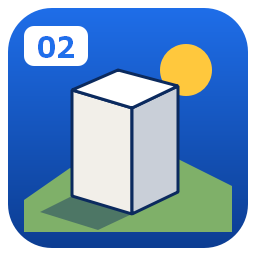

# 02 Geo3D Analyzer

**3D viewer and analyzer for terrain and extruded layers: sun hours, sky view factor, shadows, solar PV, visibility, wind and thermal-comfort screening, terrain sections, flooding and cut/fill, with results returned to QGIS.**

---

> 📖 **Illustrated Reference Manual & Visual Guide:** [read it on GitHub (docs/MANUAL.md)](docs/MANUAL.md) or [online at geophilo.com](https://geophilo.com/zero2geospatial3d/) — step-by-step walkthrough, visual diagrams, mathematical formulations, and standards. The plugin's *Manual* buttons open the online edition. Its source is [`docs/index.html`](docs/index.html); `python tools/build_manual_md.py` rebuilds the Markdown copy from it.

## Why 02 Geo3D Analyzer?

Planning questions about sun, sky, wind and heat are three-dimensional, but most of
them are still answered on flat maps. This plugin builds a 3D scene from a DEM and
your QGIS layers in three steps, runs the analyses on the GPU in the browser, and
sends every result back to QGIS as a GeoTIFF or as fields on the buildings — so the
answer ends up in your project, not in a screenshot.

## ✨ Features

- **Three steps** — pick a DEM, tick the layers (each with a role, a height expression and its QGIS colours), press *Open in 3D*; or *Quick 3D* to see a DEM alone in one click.
- **Large DEMs** — tiled terrain with level of detail keeps grids up to 4096 × 4096 cells smooth.
- **Any extrusion** — buildings and walls from any field or expression (with a bottom height for raised parts and OSM building parts), stood on the lowest, average or highest ground of a slope, trees and poles from points; colour and filter by any attribute or analysis result; heights from any field for 3D bar maps.
- **Sun and sky** — sun hours and shadow share for any day, sky view factor, annual irradiation with rooftop and facade PV yield; ground, roofs and facades are all analysed.
- **Microclimate & Comfort** — Surface energy balance with Bowen ratio partitioning, Physiological Equivalent Temperature (PET, MEMI energy balance) alongside UTCI, surface-aware Mean Radiant Temperature, ground surface temperature, and canopy evapotranspiration cooling (ΔTa); continuous 24-hour animated diurnal comfort studies (`diurnalStudy`) and interactive What-If 3D tree planting with live shading and cooling advection.
- **Ventilation & Air Quality** — Street-canyon ventilation efficiency (VEI), normalized air age (τ), and OSPM-inspired traffic pollutant dispersion (NO2 and PM2.5) with canyon vortex trapping and tree canopy filtration; animated 3D wind streamlines in the viewport.
- **Acoustic Screening & Noise** — 3D environmental noise propagation (ISO 9613-2 / CNOSSOS-EU proxy) with Maekawa barrier diffraction, road sound power emission, and quiet-facade detection for buildings. Roads come from any QGIS line layer with the *Roads* role (a *Traffic* expression per road, e.g. `"lanes"`), from OpenStreetMap with traffic by road class, or from lines drawn in the viewer.
- **Green View & Solar Envelope** — Panoramic eye-level Green View Index (GVI) evaluating visible green canopy and surface vegetation; Knowles / BRE 3D Solar Envelope maximum buildable height limits and floor capacity preserving neighbours' solar access.
- **Climate & Weather** — EnergyPlus weather files (or the nearest TMYx station, downloaded in one click), pedestrian wind screening, heat-island morphology and approximate Local Climate Zones; climate rasters draped on the ground and averaged per building.
- **Terrain** — shading by slope, aspect or elevation, contours, vertical exaggeration, sections with building silhouettes (PNG, CSV, DXF), water-level flooding, cut and fill with a balancing level; terrain maps (elevation, slope, aspect, hillshade, curvature, topographic position, ruggedness, wetness index) that open side by side in up to 8 panels and go to QGIS as GeoTIFFs.
- **Compare and optimise** — scenario A and B difference maps; an NSGA-II search over floor counts that trades floor area against sun on the open ground, optionally within planning constraints (sun around each building, the BRE 209 daylight test for the neighbours' windows) at no extra cost per design, and a full planning check of the chosen design.
- **Share** — images up to 8K with legend and north arrow, a one-page PDF sheet, an interactive single-file HTML, a GLB model and orbit or sun-through-the-day videos.
- **Compare** — swipe between two analyses or scenarios, or 2, 4, 6 or 8 synced panels; a shadow study plays the day with the sun clock; 24-hour diurnal thermal cycle animations.
- **Building report & Inspector** — click a building for every result with its rank among the others, what scenario B changes for it, its year of outdoor comfort by season and its own wind rose per season; ground inspector with 24-hour diurnal curves and stereographic sun-path diagrams; analyse it in one click, save a one-page PDF.
- **Planning check** — pass or fail per building for sun on the surrounding open ground, facade daylight, daylight kept after scenario B, facade noise (WHO threshold), green view index, windy and summer heat-stress hours, with editable thresholds saved as reusable profiles; buildings painted green, amber or red (also in QGIS, 2D and 3D), and a one-page planning sheet (PDF) and CSV. Screening proxies of BRE 209, not formal assessments.
- **Back to QGIS** — GeoTIFF layers and a results GeoPackage per building layer, extruded and coloured in QGIS's own 3D view; selection is shared both ways.

## 🚀 Installation

**From the QGIS Plugin Hub (recommended):** `Plugins → Manage and Install Plugins…` → search for **"02 Geo3D Analyzer"** → *Install*.

**From a release zip:** download the latest zip from [Releases](https://github.com/YusufEminoglu/zero2geospatial3d/releases) → `Plugins → Install from ZIP`.

Requires QGIS 3.28 or newer (QGIS 4 included) and a browser with WebGL 2. No external Python dependencies.

## 📖 Quick start

1. Click the **02 Geo3D Analyzer** toolbar icon.
2. **Terrain:** choose your DEM (or leave it empty for flat ground) and the scene area.
3. **Objects:** tick the layers to show; check each layer's role and height (e.g. `"floors" * 3.2`). No buildings? Use *Download OSM buildings, trees & roads*. Give road layers the *Roads* role to feed the noise and air-quality maps.
4. Optionally add climate rasters and a weather file (*Nearest station…*).
5. **Open in 3D.** In the browser, open **Analyze**, pick a card and press *Run*; press **To QGIS** on a result to add it to your project.

## ⚙️ Reference

| Tab | Tool | What it does |
|-----|------|--------------|
| Layers | Colour by, Height, Filter | QGIS style, single colour, graduated (natural breaks, quantile, equal) or categories; heights from the QGIS expression, a field × factor, or uniform |
| Analyze | Sun hours & shadows | Direct sun hours on ground, roofs and facades for one day, share of the day in shade, BRE 2-hour check |
| Analyze | Sky view factor | Cosine-weighted visible sky (1 = open, 0.5 = open wall) |
| Analyze | Solar radiation & PV | Annual or seasonal irradiation (EPW or clear-sky), roof and facade PV yield, suitable roof area per building |
| Analyze | Visibility | Viewshed from a picked point or from the top of a selected building |
| Analyze | Wind & streamlines | Pedestrian wind ratio and speed: wakes, channelling, tall-building corners, animated 3D streamlines |
| Analyze | Thermal comfort & microclimate | UTCI, PET (Höppe MEMI), surface temperature, canopy cooling (ΔTa), and 24-hour diurnal thermal animation |
| Analyze | Canyon ventilation | Ventilation Efficiency Index (VEI) and normalized air age (τ) from pedestrian wind and SVF |
| Analyze | Pollutant dispersion | OSPM street canyon dispersion (NO2/PM2.5) with vehicle emissions and tree canopy filtration |
| Analyze | Acoustic & noise screening | 3D noise propagation (ISO 9613-2 proxy), road traffic noise (Lden), facade exposure, and quiet facades |
| Analyze | Green View Index (GVI) | Panoramic eye-level visible green canopy and vegetation fraction (0–100%) |
| Analyze | 3D Solar envelope | Knowles / BRE solar envelope maximum buildable heights and floor capacity |
| Analyze | Heat island & morphology | λp, λf, mean height, H/W, z0 (Macdonald 1998), approximate LCZ (Stewart & Oke 2012) |
| Terrain | Section & profile | Ground and building silhouettes along a drawn or QGIS line; PNG, CSV, DXF |
| Terrain | Water level & flooding | Bathtub or connected flooding, depth grid, buildings reached |
| Terrain | Cut & fill | Earthwork volumes to a design level; balancing level |
| Compare | Scenarios | B − A difference of sun, sky, irradiation or wind |
| Compare | What-If tree planting | Interactive 3D tree placement and crown scaling to simulate local cooling and shade |
| Compare | Optimise building heights | NSGA-II Pareto front of floor area vs. sun on open ground |

Methods and sources are listed in each result's note and in [THIRD_PARTY_NOTICES.md](THIRD_PARTY_NOTICES.md).

## 🧩 Part of the PlanX ecosystem

02 Geo3D Analyzer is one of the open-source QGIS plugins for urban planning by the same author:

| Planning & analysis | CAD & production | 3D & visualization |
|---|---|---|
| [PlanX](https://github.com/YusufEminoglu/PlanX) — spatial-planning suite | [PlanX CAD Toolset](https://github.com/YusufEminoglu/PlanX-CAD) — drafting-grade CAD | [PlanX 3D City](https://github.com/YusufEminoglu/planx_3d_city) — Three.js city viewer |
| [GeoStats Lab](https://github.com/YusufEminoglu/planx_geostats) — spatial statistics | [EasyFillet](https://github.com/YusufEminoglu/EasyFillet) — tangent-arc fillet | [3D OSM Model](https://github.com/YusufEminoglu/osm_3d_model) — OSM → 3D city in browser |
| [Suitability Lab](https://github.com/YusufEminoglu/planx_suitability_lab) — raster MCDA | [Settlement Toolset](https://github.com/YusufEminoglu/PlanX-Settlement) — 9-stage settlement plans | [OSM Quick 3D](https://github.com/YusufEminoglu/osm_quick_3d) — OSM → native QGIS 3D |
| [DataCube Lab](https://github.com/YusufEminoglu/planx_datacube) — spatiotemporal cubes | [UIP Toolset](https://github.com/YusufEminoglu/PlanX-UIP) — Turkish master-plan automation | [Urban Procedural 3D](https://github.com/YusufEminoglu/planx_urban_procedural_3d) — parametric zoning lab |
| [Urban Resilience](https://github.com/YusufEminoglu/planx_urban_resilience) — 28 resilience tools | [ParcelFlux](https://github.com/YusufEminoglu/parcelflux) — parcel subdivision | [02 Geo3D Analyzer](https://github.com/YusufEminoglu/zero2geospatial3d) — 3D sun, sky, wind and terrain analyses |

## 📜 License & author

MIT © [Yusuf Eminoğlu](https://github.com/YusufEminoglu) — bug reports and feature requests welcome in [Issues](https://github.com/YusufEminoglu/zero2geospatial3d/issues).
