<!-- Generated from docs/index.html by tools/build_manual_md.py; edit the HTML, then rebuild. -->

> **02 Geo3D Analyzer — Reference Manual** (v1.2.1). The styled online edition is at
> [geophilo.com/zero2geospatial3d](https://geophilo.com/zero2geospatial3d/); this copy is the same manual
> for reading on GitHub.

*02 Suite · 3D spatial analysis*

# 02 Geo3D Analyzer Reference Manual

A QGIS plugin for questions that are three-dimensional but are usually answered on flat maps. It builds a web scene from a DEM and your extruded layers in three steps, computes sun, shadow, sky, radiation, wind, comfort, terrain and earthwork results in the browser, and writes every result back into the QGIS project.

QGIS 3.28+ / 4.x · WebGL 2 · GPU raycasting · No pip dependencies · MIT license · GeoTIFF + GeoPackage output

[Start the guided walkthrough](#guide) [Read the manual](#architecture) [QGIS Plugin Hub ↗](https://plugins.qgis.org/plugins/zero2geospatial3d/) [GitHub repository ↗](https://github.com/YusufEminoglu/zero2geospatial3d)

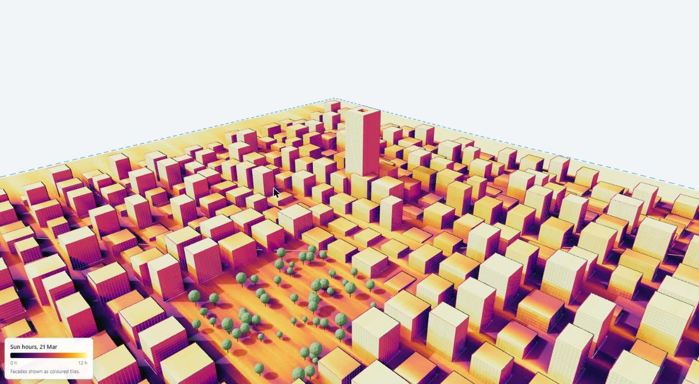

Sun hours on ground, roofs and facades for a district scene, computed from an hourly solar model and rendered over the 3D terrain.

**3** Setup steps

**4096²** DEM cells, tiled

**64–256** SVF rays per cell

**1 click** Result to QGIS

<a id="guide"></a>

*Guided walkthrough · Start here*

## End-to-end guide: every tool on real data

This walkthrough runs every tool of the viewer on two real scenes and shows what each one produces. Every screenshot is the real viewer, and every number was measured in the run described here. Follow it once from top to bottom; afterwards the chapters below are the reference.

| Scene                   | Data                                                                                | What it exercises                                                                                  |
|-------------------------|-------------------------------------------------------------------------------------|----------------------------------------------------------------------------------------------------|
| **sa** · Konak district | 30 m DEM, 2,367 building footprints with a `floors` field, EPW weather file (Izmir) | All Analyze tools, terrain tools, planning check, optimiser, exports, round trip to QGIS           |
| **kadi** · Kadifekale   | 87 × 93 DEM grid (EPSG:32635), 16,385 buildings and 14 trees from OpenStreetMap     | A steep bowl-shaped terrain: sun, wind, sections, flooding and cut and fill at the scale of a hill |

**Read the numbers as screening values.** Wind is a fast screening model and not CFD. The DEM is 30 m, while analyses run on a 2 m cell. Buildings without a height value get a default of about 9 m: in *kadi*, 16,382 of 16,385 buildings use that default, so its building results show the method and not the real city. Numbers from drawn geometry (sections, flood seeds, cut and fill) depend on where you click and will differ in your run.

#### 1 · QGIS dock

Terrain, objects, climate, open in 3D.

#### 2 · The viewer

Layout, tabs, navigation, layer card.

#### 3 · Analyze tab

Thirteen tools, from sun hours to planning check.

#### 4 · Terrain tab

Display, eight terrain maps, section, flood, cut and fill.

#### 5 · Compare tab

Scenarios and the height optimiser.

#### 6 · Exports and QGIS

Image, PDF, HTML, GLB, DXF, round trip.

<a id="g-dock"></a>

### 1 · Prepare the scene in the QGIS dock

The dock has three step cards that run top to bottom. Open it from the plugin icon; it docks on the right.

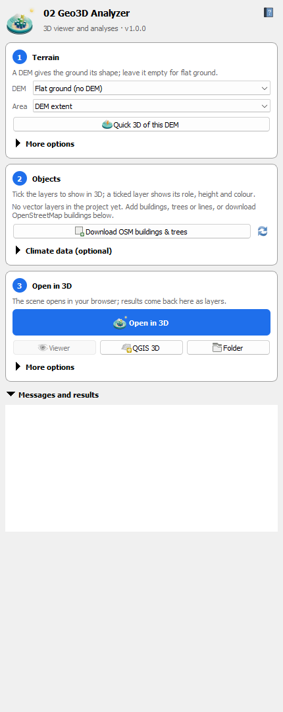

The dock before anything is loaded: *1 Terrain*, *2 Objects*, *3 Open in 3D*, and a message area.

#### Step 1 · Terrain

- **DEM**: pick a raster layer. Use a projected CRS in metres.
- **Area**: the part of the DEM to use (whole layer, canvas or a polygon).
- **Quick 3D of this DEM**: opens the terrain alone, with no objects. Good for a first look.
- **More options**: *Grid* (cell size of the displayed terrain) and *Detail limit*. The scene grid is coarser (24 m here) than the 2 m cell the analyses use.

#### Step 2 · Objects

- Add each vector layer as a row. For each row choose a **Role** (buildings, trees and so on), a **Height expression** and a **Bottom** value.
- **Colour**: take the QGIS style or a single colour. **Existing / Scenario A / Scenario B** marks which state of the design a layer belongs to.
- **Download OSM buildings, trees & roads** fills the area when you have no data. The roads carry a traffic weight by road class for the noise and air-quality maps.
- The **Climate data** fold takes extra rasters and a **Weather EPW** file; *Nearest station…* finds one for you.
- Height guess order: height fields first, then floors × 3 m. Anything else gets the default.

#### Step 3 · Open in 3D

- **Viewer** opens the browser viewer, **QGIS 3D** opens a native QGIS 3D view, **Folder** only writes the scene folder, and **Cancel** stops a running export.
- The message area ends with *Scene written*.


Layers loaded: the Konak DEM and the building layer.

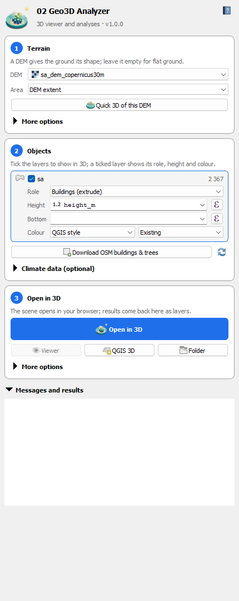

Configured: building role, height expression, and the EPW weather file in the Climate data fold.

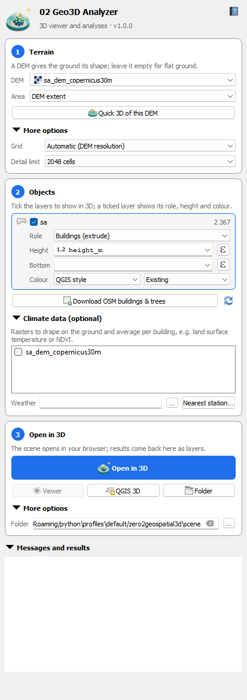

The *More options* folds expanded.

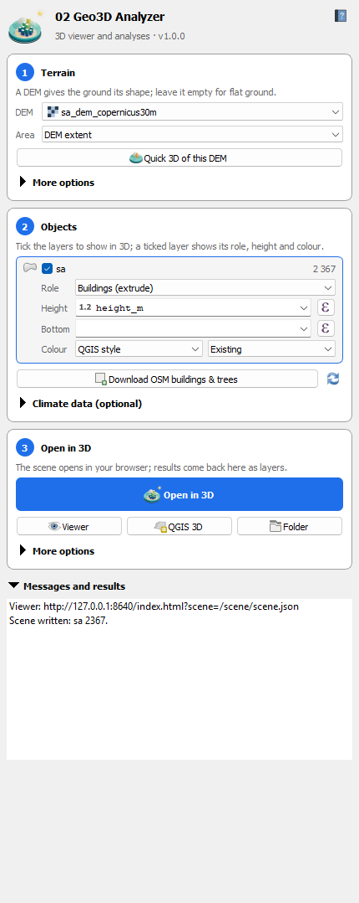

After *Open in 3D*: 2,367 buildings were exported and the dock reports *Scene written: sa 2367*.

<a id="g-viewer"></a>

### 2 · The viewer

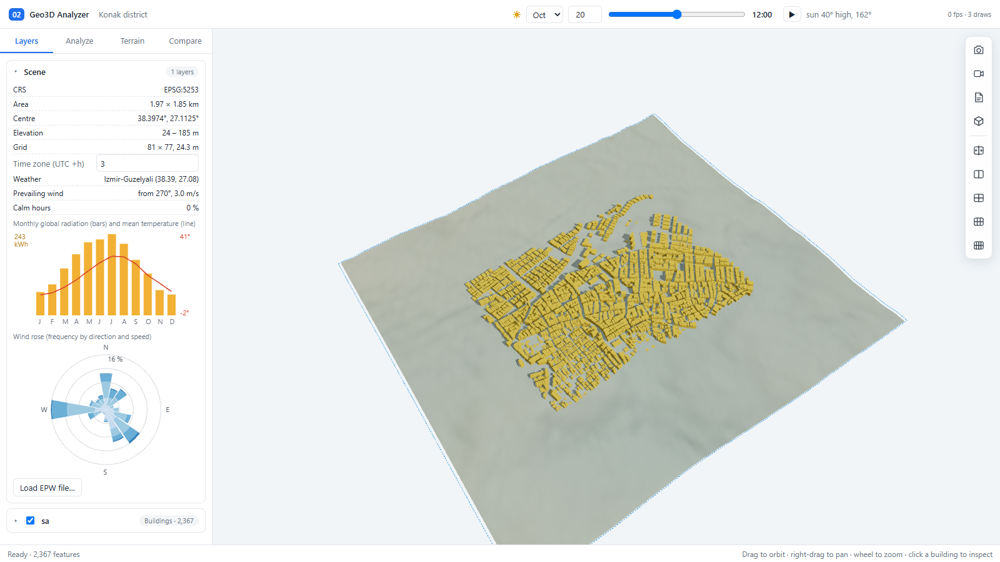

The scene as first opened. The default camera sits far away, so the first move is to frame the buildings.

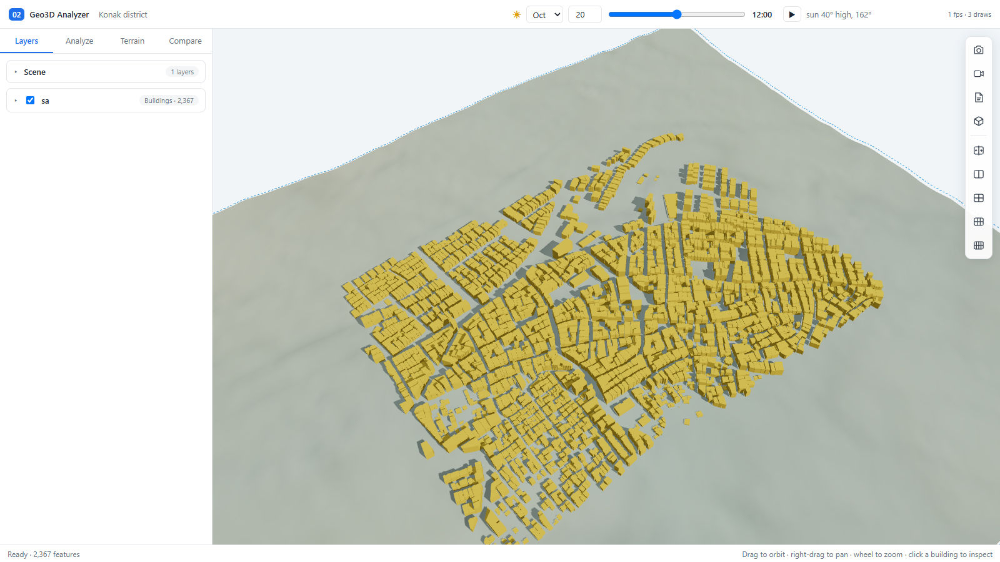

After *Zoom to* on the building layer.

| Area            | What it does                                                                                                                             |
|-----------------|------------------------------------------------------------------------------------------------------------------------------------------|
| Top bar         | Month, day, time slider and a play button for the sun position, plus a read-out such as *sun 40° high, 162°* and a frame counter.        |
| Left panel tabs | **Layers**, **Analyze**, **Terrain**, **Compare**. Every card exists at all times; the tabs only show or hide them.                      |
| Results list    | At the bottom of the panel. Each result has *Hide*, *To QGIS*, *.asc*, *CSV* and *×*, and a shared *Overlay opacity* slider.             |
| Toolbar (right) | Save an image, record a video, save a PDF sheet, 3D model or interactive page, swipe between two views, and 2 / 4 / 6 / 8 synced panels. |
| Status bar      | The last message, and the navigation hint.                                                                                               |

**Navigation:** drag to orbit, right-drag to pan, wheel to zoom, click a building to inspect it. In drawing tools, click points, then press Enter or double-click to finish; Backspace removes the last point and Esc cancels. Clicks must land on the terrain, not on the sky.

#### Layers tab


The *Scene* card: *Load EPW file…* and the time zone. Climate tools need this file.

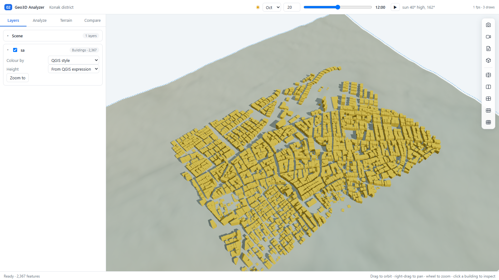

The per-layer card: *Colour by* (any numeric field, including result fields), *Height rule*, and *Zoom to*.

<a id="g-analyze"></a>

### 3 · Analyze tab (scene *sa*)

Each tool is a card: set the parameters, press the run button, and a result appears in the list with a legend, a statistics block and a draped map. All runs below used the default 2 m analysis cell.

#### 3.1 Analysis area

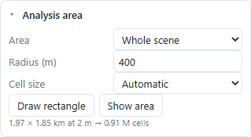

Draw a rectangle to set the area that analyses run on. A smaller area makes every tool faster.

#### 3.2 Sun hours and shadows

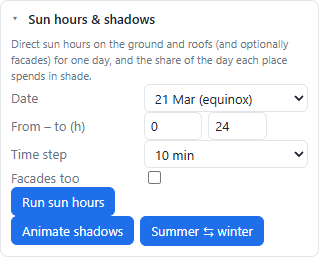

Parameters: *Date*, *From – to (h)*, *Time step*, *Facades too*. Buttons: *Run sun hours*, *Animate shadows*, *Summer ⇆ winter*.

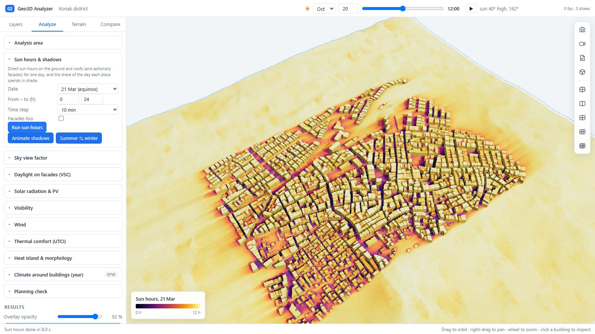

21 March, 0–24 h, 10 min step, finished in 8 s. Possible sunshine is 12.0 h; open ground averages 10.13 h; 94 % of the area gets at least 2 h; the shade statistic is 1.87 h on average, a 16 % share, and 1 % is shaded all day.

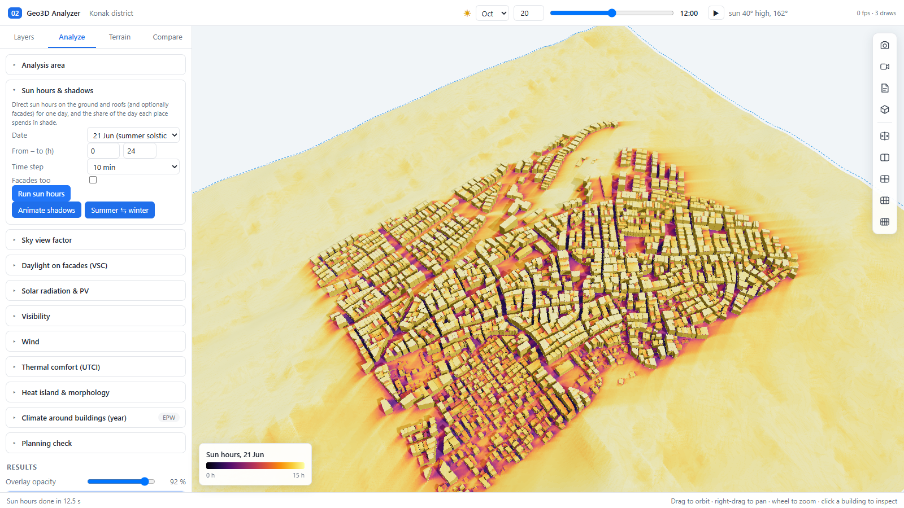

21 June: 14.5 h possible; open-ground mean 12.82 h; 98 % at least 2 h.

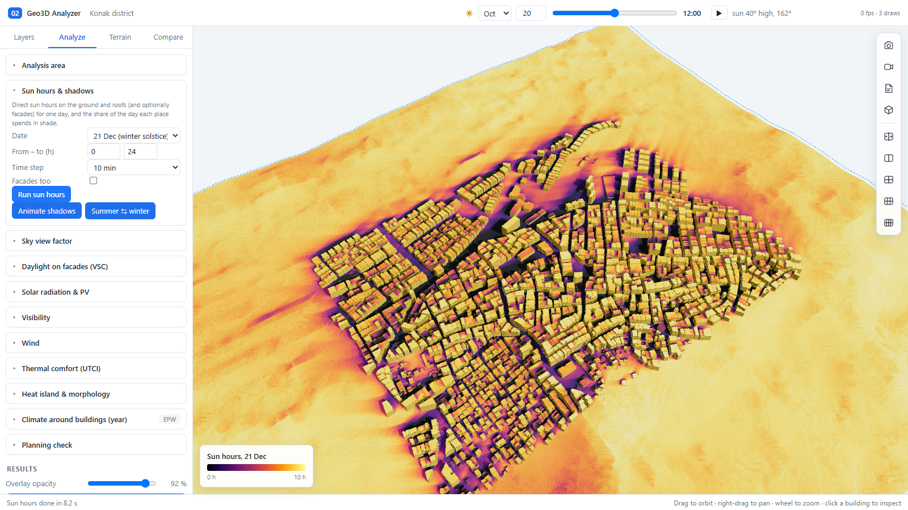

21 December: 9.3 h possible; open-ground mean 7.16 h; 89 % at least 2 h.

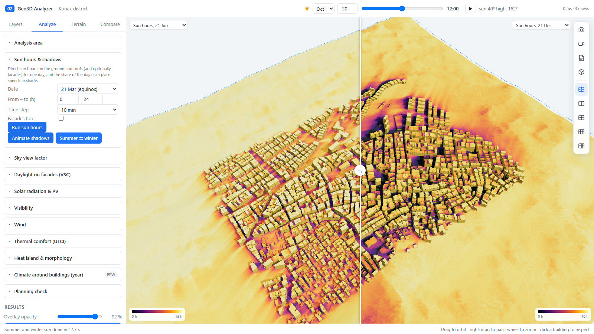

*Summer ⇆ winter* sets up a swipe between the 21 June and 21 December results. Leave swipe mode with the toolbar button before the next step.

**Facades too** adds sun hours on walls. Leave it off for ground and roofs; it is slower. *Animate shadows* plays the live shadows through the chosen hours.

#### 3.3 Sky view factor

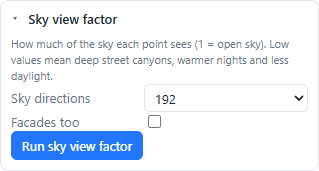

192 sky directions by default.

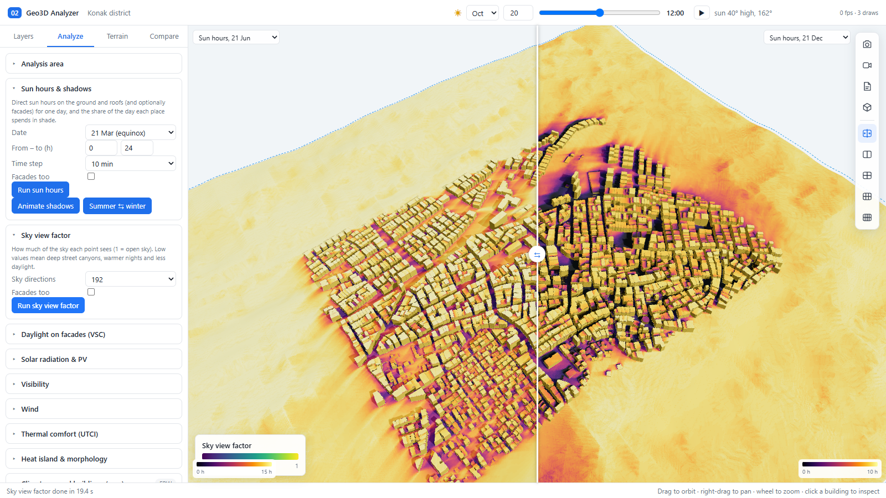

Open ground averages 0.91; the minimum is 0.00 in the deepest canyons. About 19–22 s.

#### 3.4 Daylight on facades (VSC)

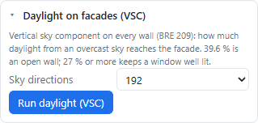

Vertical sky component under a CIE overcast sky, 192 directions.

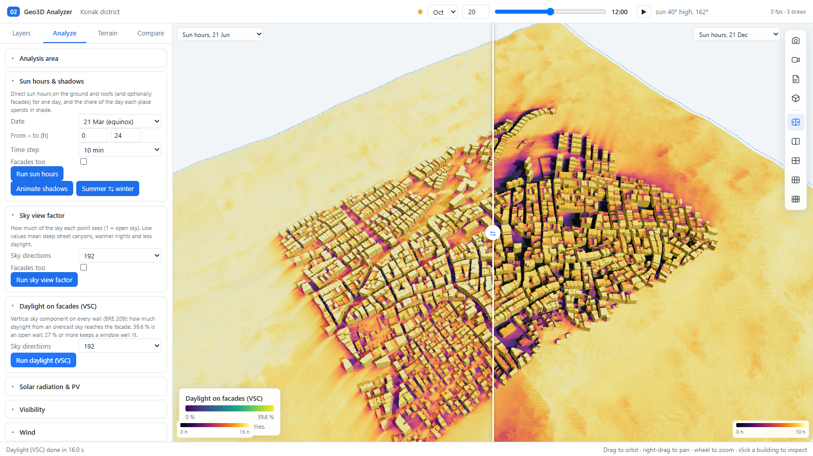

Mean VSC on walls is 18.7 %. 32 % of the wall area reaches 27 % or more, and 156 of 2,367 buildings have a mean of 27 % or more. Party walls (31 % of the wall area) are left out. 16–18 s.

#### 3.5 Solar radiation and PV

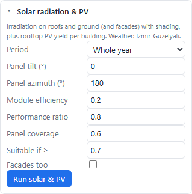

The *Period* choices are whole year, summer (Jun–Aug), winter (Dec–Feb) and heating season (Oct–Apr).


Whole year: roof PV 61,459,552 kWh/yr on 223,265 m² of suitable panel area. An unshaded horizontal surface receives 1,819 kWh/m² a year; the maximum on the map is 1,801. 26–41 s.

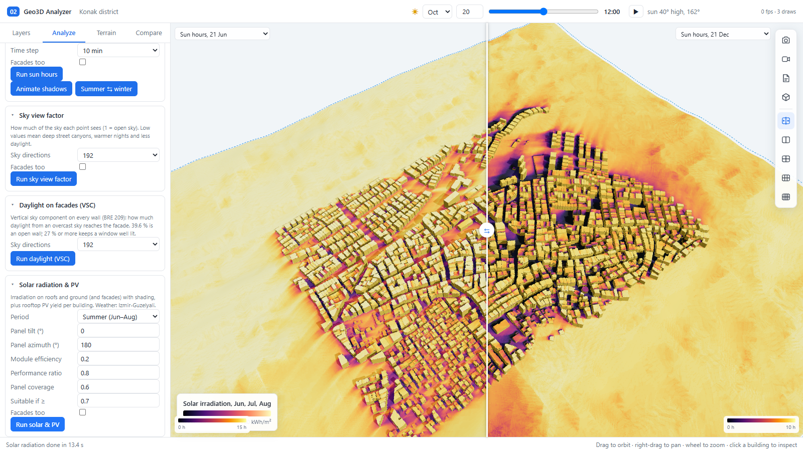

Summer (June–August): 23,976,032 kWh on 228,482 m²; horizontal unshaded 685 kWh/m². 13 s.

#### 3.6 Visibility

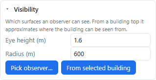

*Eye height* 1.6 m, *Radius* 600 m. *Pick observer…* lets you click a point; *From selected building* maps where that building can be seen from: the ground and roofs that see any of eight points along its top edge.

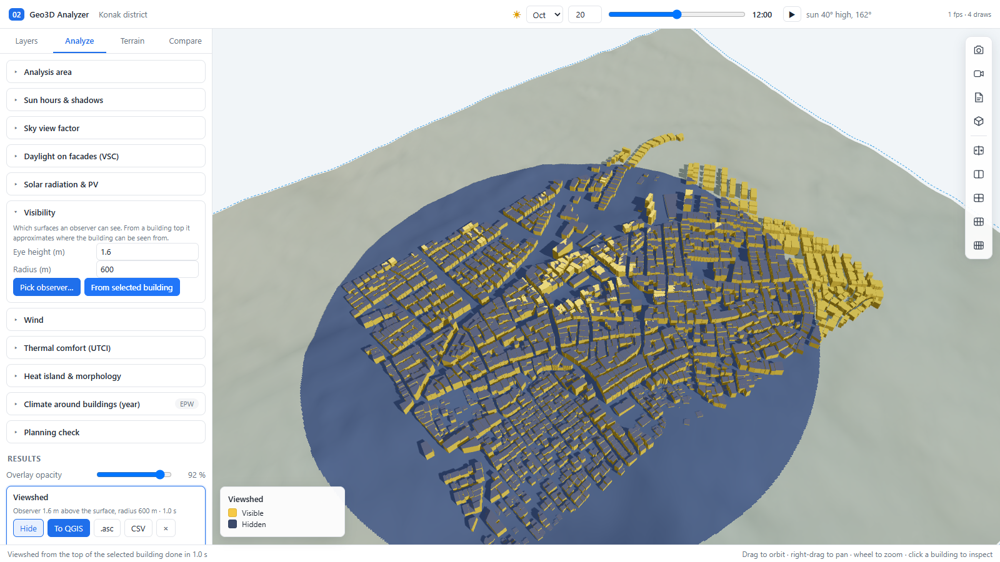

Viewshed from one selected building, yellow visible and blue hidden, as version 1.2.0 computed it: from the centre of the roof, whose own edge hides most of the ground (1 %, 15,608 m²). From 1.2.1 the tool traces from the building's top edge instead, so the map shows where the building can be seen from; a 96 m tower in a test scene is seen from 48 % of the area.

#### 3.7 Wind

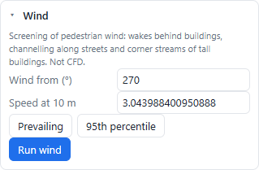

*Prevailing* and *95th percentile* fill the direction and speed fields from the wind rose of the EPW file (prevailing speed or the 95th percentile speed); you can also type your own. *Run wind* computes.

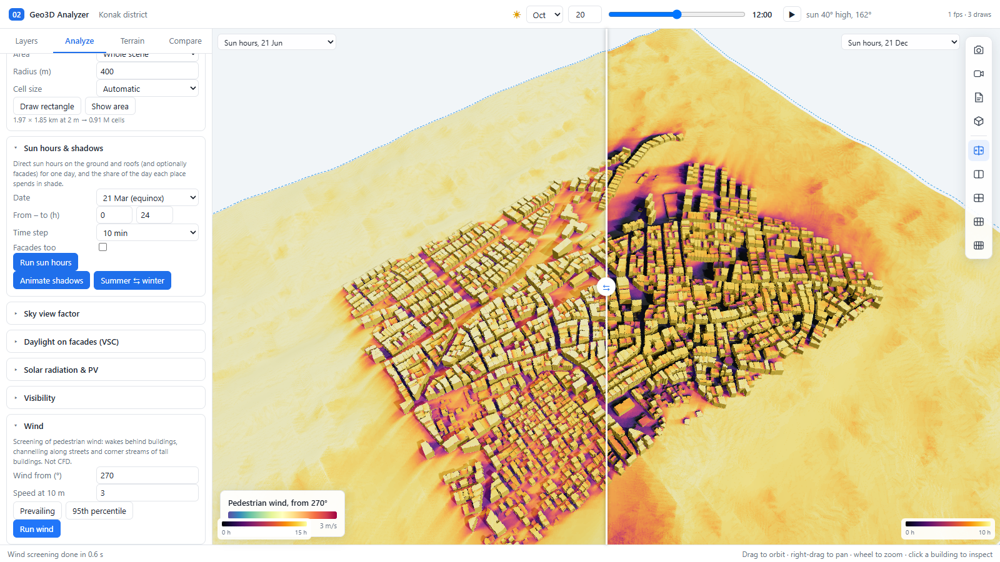

Prevailing wind from 270° at 3.0 m/s: open ground 2.0 m/s, mean 1.9 m/s, 7 % of the area sheltered, 100 % in the Sitting comfort class. 0.6 s.


95th percentile wind, 5.4 m/s: open ground 3.6 m/s, mean 3.4 m/s.

#### 3.8 Thermal comfort (UTCI)

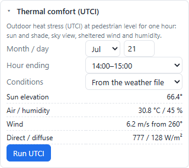

Month and day, hour range, and weather taken from the EPW file.


21 July, 14–15 h: air 30.8 °C, humidity 45 %, wind 6.2 m/s. Mean UTCI 33.0 °C (range 27.6–36.1). Strong heat stress covers 95 % of the area and moderate heat stress 5 %.

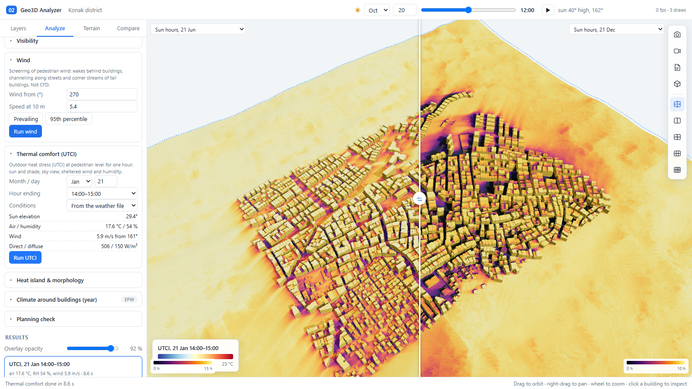

January: air 17.6 °C, mean UTCI 15.1 °C (range 7.2–22.5), no thermal stress over 100 % of the area.

#### 3.9 Heat island and morphology

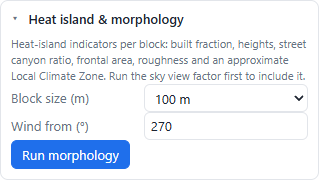

Block size 100 m (50, 100, 200 or 250 m are offered).

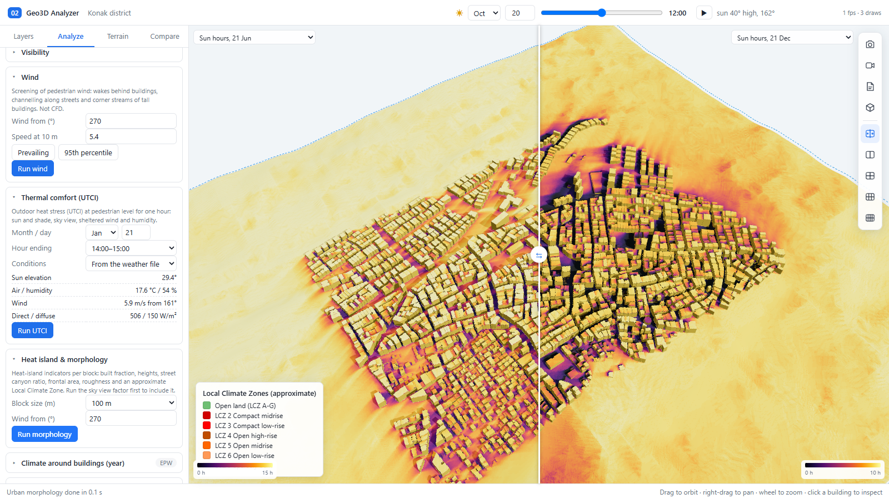

Approximate Local Climate Zones per block: open land 72 %, LCZ 2 (compact mid-rise) 13 %, LCZ 5 (open mid-rise) 11 %, LCZ 9 2 %, LCZ 3 1 %. 0.1 s. These are approximate classes from morphology, not a satellite classification.

#### 3.10 Climate around buildings (year)

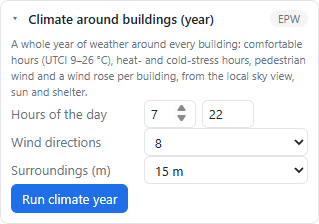

Needs the EPW file. Hours 07–22, comfort band UTCI 9–26 °C.

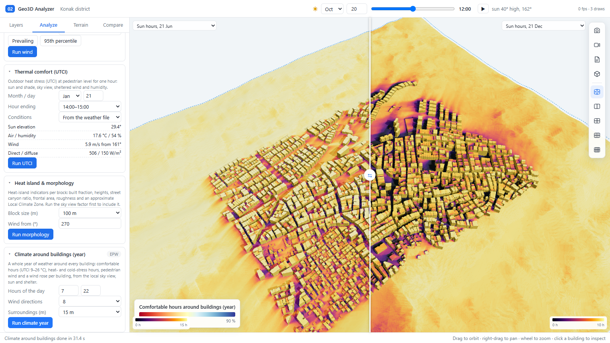

2,361 buildings, 5,475 hours each, 83 sun positions. Mean comfortable share 58 %. 31–41 s. It writes per-building fields such as comfortable hours, heat-stress hours and cold-stress hours.

#### 3.11 Planning check

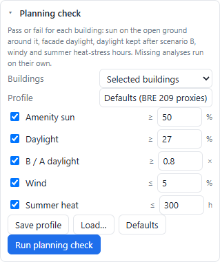

Choose *Buildings* (selected, all in the analysis area, or scenario B), a *Profile*, and switch criteria on or off. Defaults follow BRE 209 proxies: amenity sun ≥ 50 %, daylight (VSC) ≥ 27 %, neighbour daylight B/A ≥ 0.8, wind ≤ 5 % windy hours, summer heat ≤ 300 h. *Save profile…* and *Load…* keep your own thresholds.

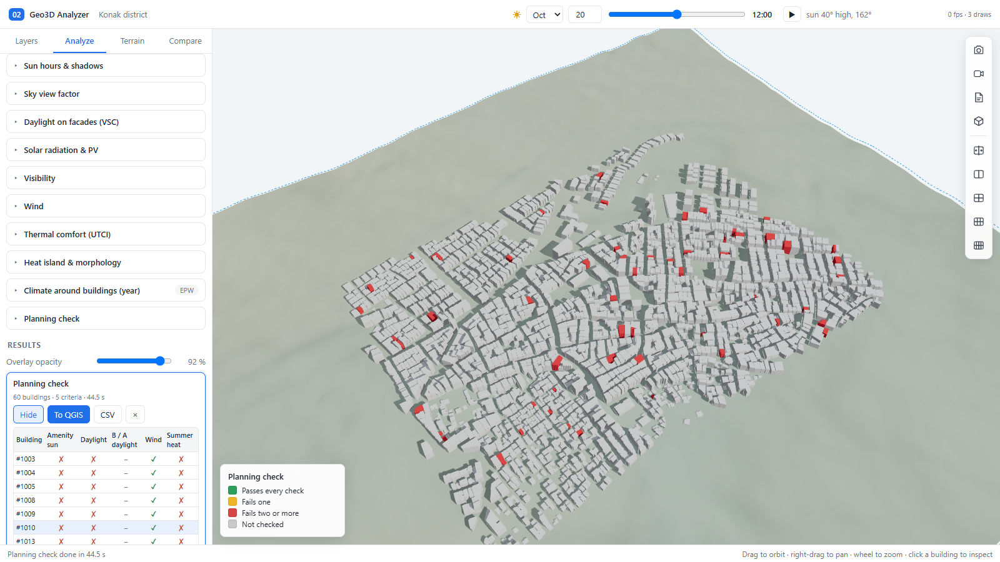

Run on 60 selected buildings: none passes every check. Amenity sun 24 of 60, daylight 1 of 60, wind 60 of 60, summer heat 0 of 60 (the B/A criterion needs scenario B and is skipped). Green passes everything, yellow fails one, red fails two or more, grey is not checked. 18–75 s depending on which analyses had to be run first.

The result table lists the worst buildings first and exports to CSV and PDF. The result fields are `check_failed`, `check_amenity_sun`, `check_facade_vsc`, `check_neighbour_daylight`, `check_wind` and `check_heat`.

#### 3.12 Building inspector

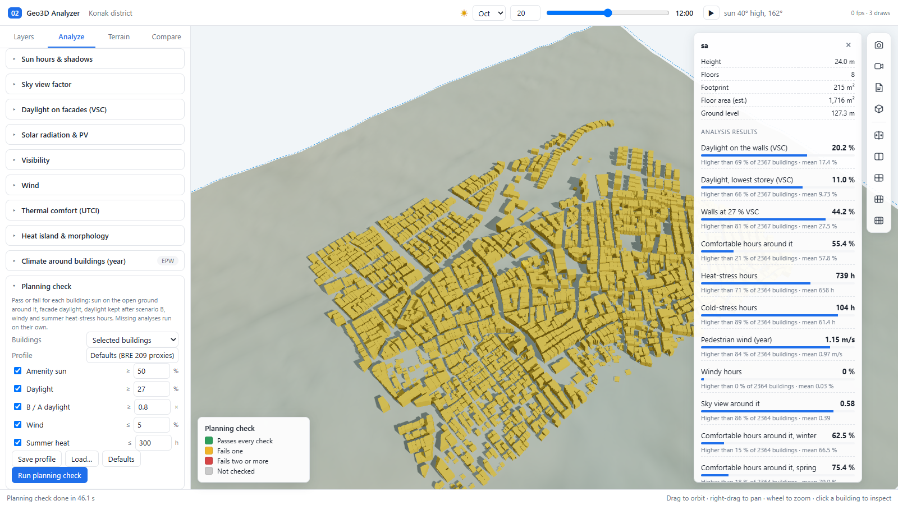

Click any building. The top block gives the facts (24 m, 8 floors, 215 m² footprint, about 1,716 m² floor area, ground at 127.3 m). Below, every analysis you have run is ranked against all other buildings: daylight on walls 20.2 % (higher than 69 % of 2,367 buildings, mean 17.4 %); comfortable hours 55.4 %; heat-stress 739 h; pedestrian wind 1.15 m/s; sky view around it 0.58.

<a id="g-terrain"></a>

### 4 · Terrain tab

#### 4.1 Display

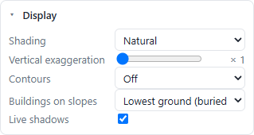

*Shading*, *Vertical exaggeration* (a slider), *Contours*, *Buildings on slopes* and *Live shadows*.

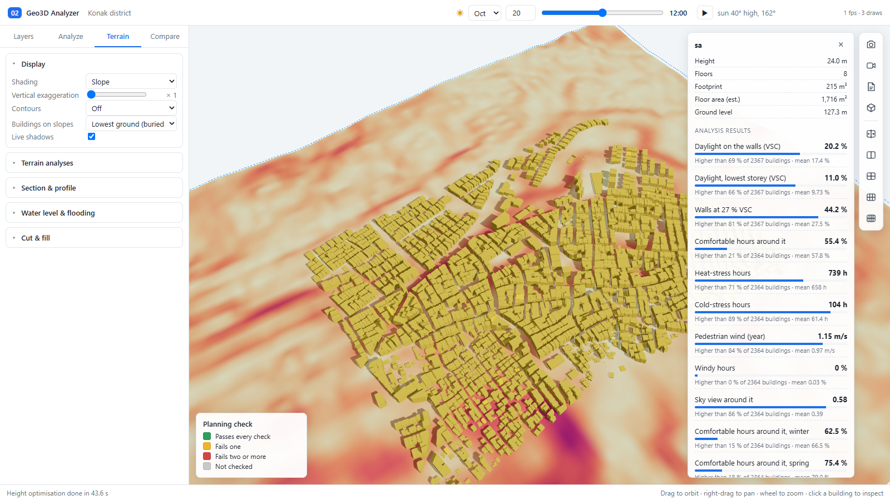

Slope shading.


Contours on.

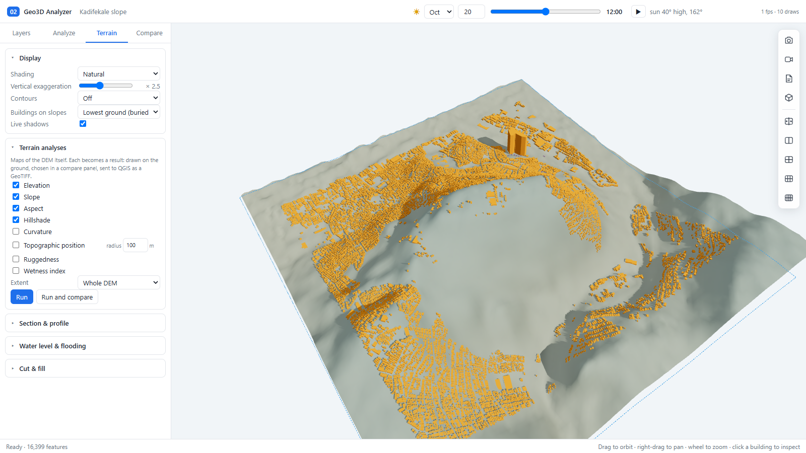

Vertical exaggeration on the steep Kadifekale terrain makes the bowl shape easy to read. It changes the picture only, never the analysis numbers.

#### 4.2 Terrain analyses

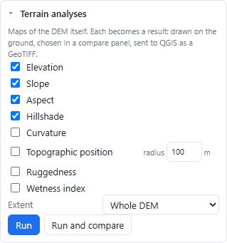

Elevation, slope, aspect and hillshade are on by default. Curvature, topographic position (radius 100 m), ruggedness and wetness index are off. *Extent* is the whole DEM or the analysis area. *Run* adds results to the list; *Run and compare* also opens the compare panels.

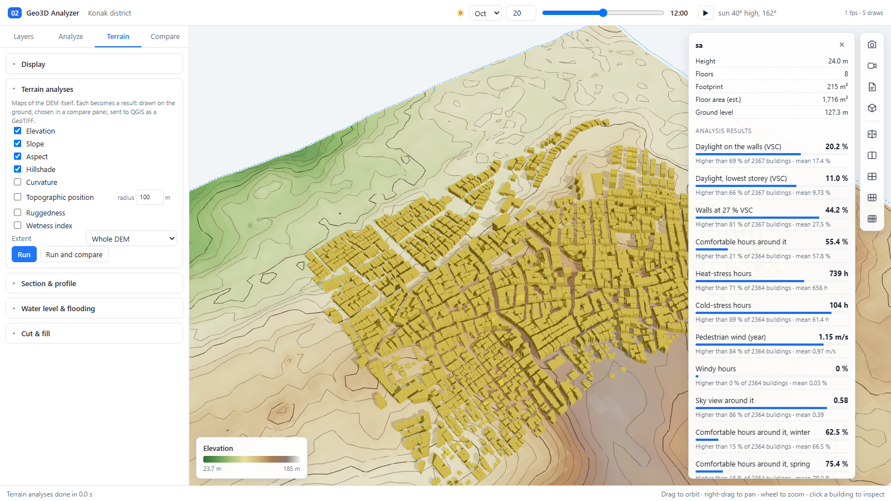

Konak, 24 m cells: elevation 23.7–185.1 m (mean 106.8, relief 161.5 m); slope mean 6.6° (11 %), steepest 23.8°. Slope classes: under 5 % = 17.0 %, 5–10 % = 31.1 %, 10–15 % = 25.3 %, 15–30 % = 25.0 %, 30 % or more = 1.6 %. Aspect: flat 2.1 %, N 23.9 %, NE 13.2 %, E 7.9 %, SE 8.0 %, S 7.7 %, SW 8.7 %, W 11.5 %, NW 17.1 %. Hillshade is lit from the northwest at 45°.

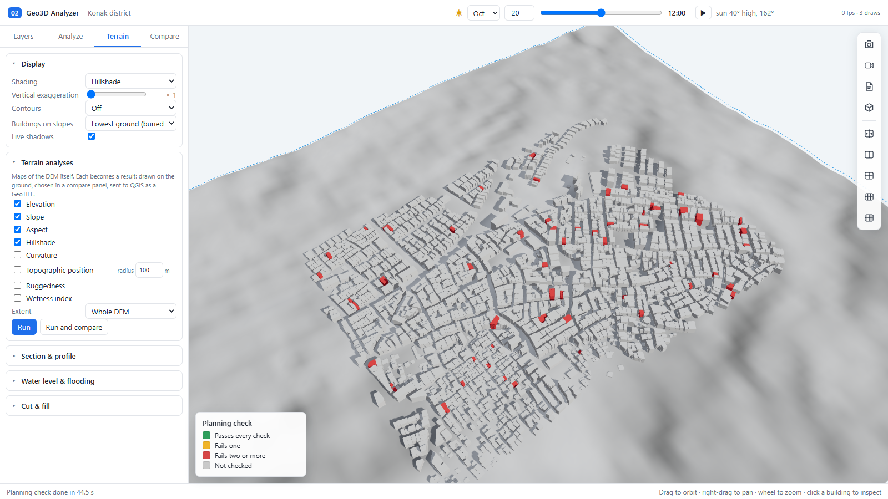

Hillshade.

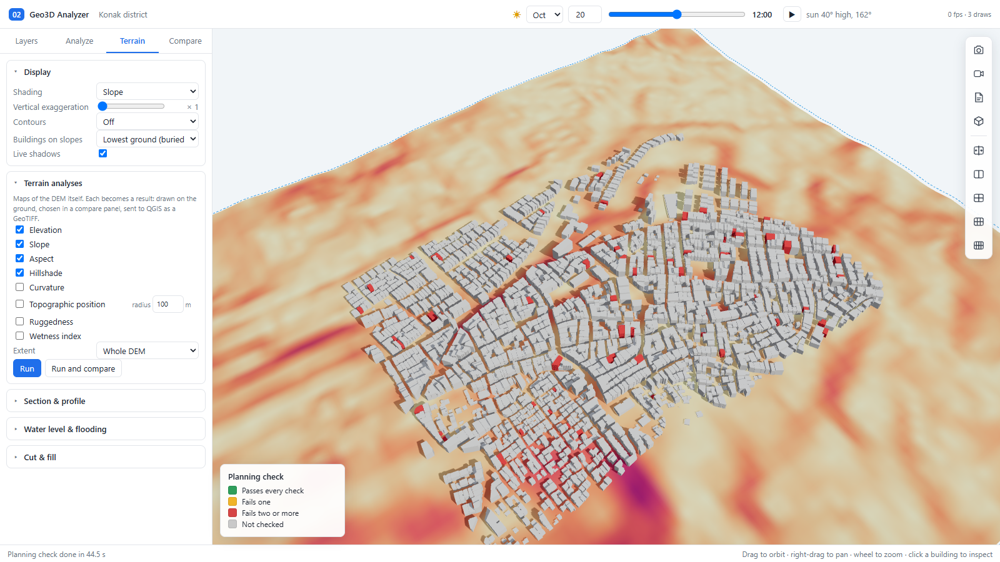

Slope.

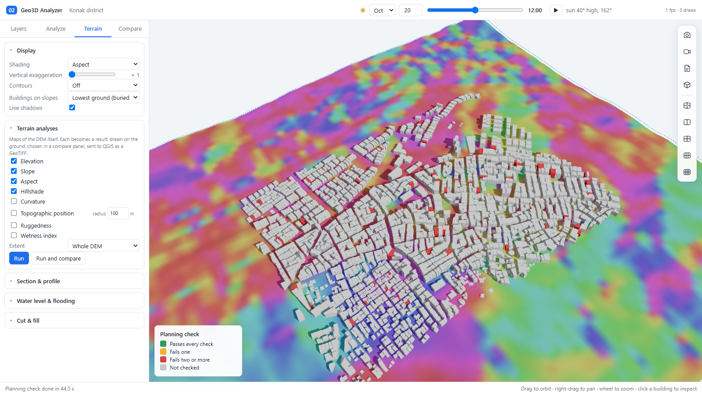

Aspect.

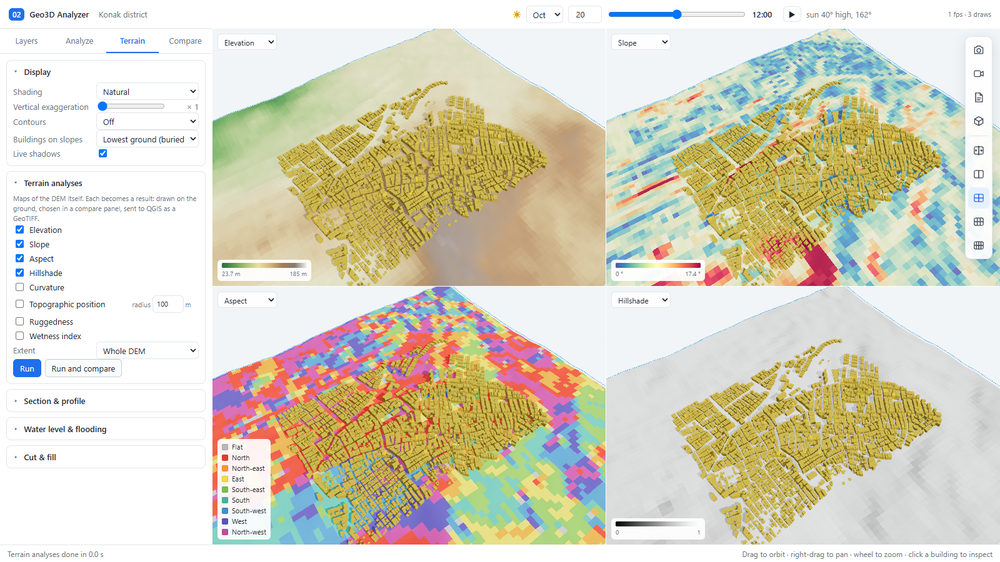

Run and compare: panels side by side. Exit with the compare button in the toolbar.

The same tools on Kadifekale (elevation 3.86–186 m):

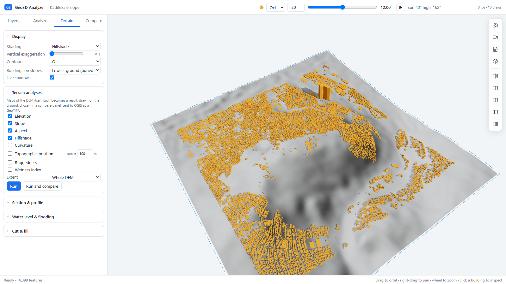

Hillshade.

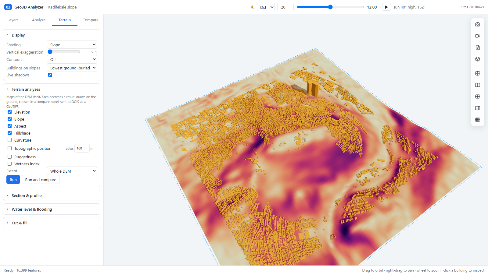

Slope.

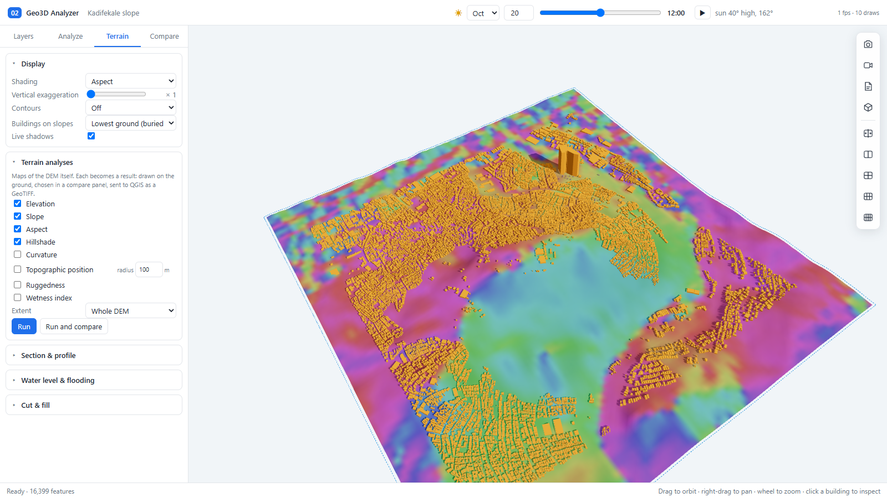

Aspect.

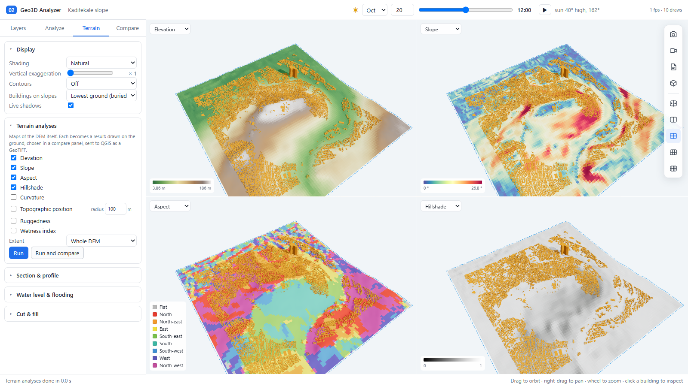

Compare panels.

#### 4.3 Section and profile

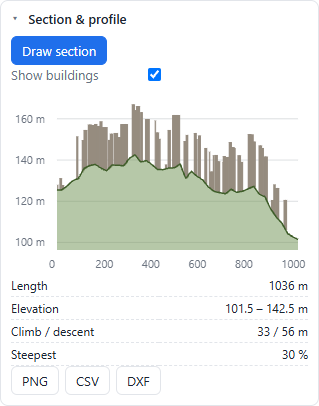

Draw a line on the terrain: click points, then Enter. The profile includes the buildings it crosses.

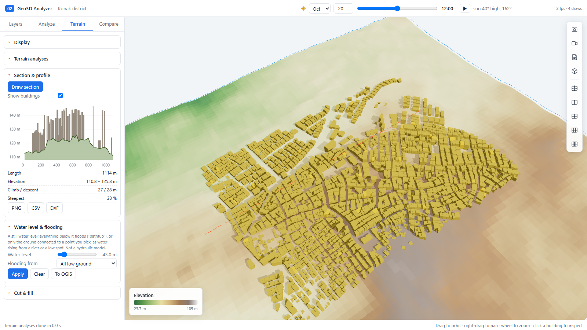

A 1,114 m line over Konak: elevation 110.8–125.8 m, climb 27 m, descent 28 m, steepest 23 %. Export as CSV, PNG or DXF.

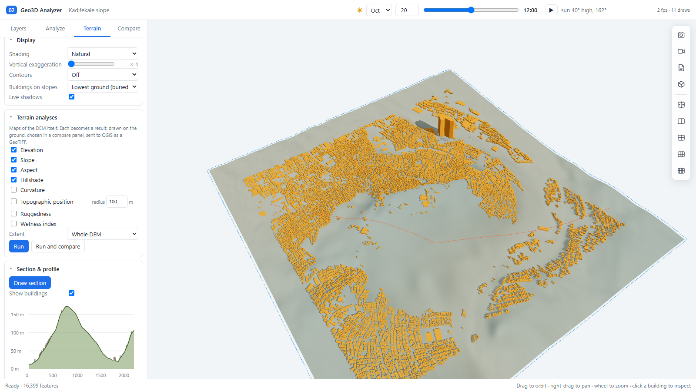

Three clicks across Kadifekale: 2,251 m long, elevation 12.2–173.4 m, climb 249 m, descent 154 m, steepest 49 %.

#### 4.4 Water level and flooding

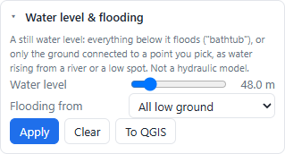

A water-level slider (it starts 15 % up the elevation range) with *Apply* and *Clear*. Without a seed point, every cell below the level floods; a picked seed floods only the connected area.


Konak at 43.0 m: 7.50 ha flooded, volume 495,678 m³, deepest 19.31 m, no buildings reached.


Kadifekale at 25.9 m: 152.95 ha, volume 15,744,635 m³, deepest 22.02 m, **2,496 buildings reached**. Reached buildings get a `flood_depth_m` field when sent to QGIS.

#### 4.5 Cut and fill


Draw a platform polygon, choose a level or *Balance*, and run.


Balance on a 65,510 m² platform: cut 192,963 m³, fill 192,966 m³, net 3 m³.


Kadifekale, 195,913 m² platform: cut 1,280,891 m³, fill 1,281,805 m³, net 914 m³, balanced level 141.99 m.

#### Kadifekale: the scene and sun and wind on a hill


Kadifekale: 16,385 buildings and 14 trees on a steep bowl. The dock reported *Ready · 16,399 features*.


The Scene card for this scene: CRS EPSG:32635, 2.11 × 2.25 km, elevation 4–186 m, 87 × 93 grid at 24.3 m, weather Izmir-Guzelyali, prevailing wind from 270° at 3.0 m/s, monthly radiation and temperature chart, and the wind rose.


21 March: open ground 8.69 h, 90 % at least 2 h, shade mean 3.31 h (28 %), 2 % shaded all day. 5–8 s.


Wind: open ground 2.0 m/s, mean 1.8 m/s, 14 % sheltered.

<a id="g-compare"></a>

### 5 · Compare tab


*Scenarios* compares results between layers marked *Scenario A* and *Scenario B* in step 2 of the dock. It needs both layers; the Konak scene has none, so this card was not run here.


The 2 / 4 / 6 / 8 panel buttons show several results at once with one shared camera.

#### Optimise building heights


Select buildings first. Set the floor height, the floor range, the sun date and hours and the ground level, then the population and generation counts and a seed.


An NSGA-II run on 12 selected buildings (3.2 m floors, 1–12 floors, sun on 21 December 8–16 h, population 16, 12 generations, seed 1) evaluated 91 designs; 16 are on the Pareto front (floor area from about 2,580 to 22,800 m² against sun on open ground, top value 1.76 h). About 59 s.


Click a point on the chart to apply that design's heights to the scene; the ringed point marked "now" is the current design.

<a id="g-export"></a>

### 6 · Exports and the round trip to QGIS


*Save an image*: PNG, with a copy-to-clipboard option. Measured file: 1.3 MB for the full view.


*Save a PDF sheet*: view, legend and result statistics on one sheet (344 KB).


*Interactive HTML* (8.3 MB, one self-contained file) and *GLB model* (6.4 MB) for other 3D software.


*Record a video* captures the animated sun or the camera. This panel was shown but a recording was not produced in this run.

The section tool also writes a profile CSV (34 KB) and a DXF (49 KB).

#### To QGIS


Each result has a *To QGIS* button.

The viewer sends results back through the loopback bridge. In this run:

- Sun hours, 21 March became a GeoTIFF (984 × 927 cells at 2 m) and 2,363 buildings received the `sun_h_roof` field.
- Pedestrian wind became a GeoTIFF (563 × 530 at 3.5 m).
- Flood depth became a GeoTIFF (81 × 77 at 24.29 m); no building was reached, so no `flood_depth_m` value was written.
- The planning check wrote the six `check_*` fields to the 40 buildings it covered.


The sun-hours GeoTIFF rendered in QGIS over the updated building layer.


The wind GeoTIFF rendered in QGIS.

Per-building results are written back to the **same source layer** in the project, in a results GeoPackage next to the scene. If that layer is removed from the project before you press *To QGIS*, the update is rejected with a message; keep it loaded.

### Not covered in this run

These controls exist but were not run on the guide data, so no numbers are given for them: the *Scenarios* comparison (needs scenario A and B layers), *Pick observer…* (a click-picked viewshed), flooding from a picked point, manual UTCI conditions, *Facades too* in sun hours, video recording, *Load EPW file…* from the viewer (the file was supplied in the dock), and the 8 and 16 wind direction options. The matching reference chapters below describe them.

<a id="architecture"></a>

*01 · System design*

## Two runtimes, one scene

02 Geo3D Analyzer separates orchestration from computation. Python inside QGIS knows about layers, fields, expressions, coordinate systems and the user's project. The browser knows about geometry, light and the GPU. A small loopback HTTP bridge connects the two, so heavy per-pixel analysis never blocks the QGIS interface and results arrive as ordinary project layers.

#### Python · QGIS process

- Three-step dock: terrain, objects, open in 3D.
- Reads DEM tiles and extrudes features from any layer, field or expression.
- Carries layer colours, height rules, bottom heights and filters into the scene.
- Downloads OSM buildings, trees and roads for the scene area.
- Receives results, writes GeoTIFFs and a results GeoPackage, applies 3D styling.
- Shares the QGIS selection with the viewer in both directions.

#### Browser · Three.js + WebGL 2

- Renders terrain, extrusions, trees, poles and result overlays.
- GPU raycasting for sun visibility, sky sampling and shadow casting.
- Analysis runners for sun, SVF, radiation, PV, wind, comfort and morphology.
- Terrain sections, flooding and cut/fill on the elevation grid.
- NSGA-II optimisation and scenario difference maps.
- Exports images, PDF sheets, interactive HTML, GLB and video.

**127.0.0.1** · local HTTP bridge · **POST /api/result** · **POST /api/select** · **GET /api/selection** · **GET /api/ping**

### Why a local bridge instead of QGIS-only computation

Sun visibility, sky sampling and shadow maps are naturally parallel per cell. Running them in Python would either serialise millions of ray tests or require a compiled extension. The browser already ships a mature WebGL 2 implementation on every platform, so the plugin uses fragment and compute-style passes for the expensive part and keeps QGIS responsible for data and persistence.

Isolation

#### QGIS never blocks

The server runs on its own thread and queues results. QGIS objects are touched only on the QGIS thread, never from the HTTP handler.

Privacy

#### Loopback only

The server binds to `127.0.0.1`. The scene is served from a temporary folder on the same machine; no cloud service is involved.

Freshness

#### No stale terrain

Scene responses are sent with `Cache-Control: no-store`, so a new export can never be shadowed by a cached scene at the same URL.

### Scene model

The exported scene packages the project CRS, a local origin, terrain tiles with level of detail, one mesh group per QGIS layer, per-feature attributes used for colouring and reporting, and the analysis metadata (latitude, longitude, time zone, weather station). Grids travel as typed arrays; results return as indexed grids plus per-building field arrays, which is what makes a one-click round trip possible.

**Large DEMs.** Terrain is tiled and rendered with level of detail. Grids up to 4096 × 4096 cells remain interactive because distant tiles are decimated while the analysis still runs on the full resolution grid.

<a id="workflow"></a>

*02 · Operator workflow*

## DEM → layer selection → 3D session

The dock is deliberately short. Everything that can be inferred from the project is inferred; everything that changes the meaning of a result stays visible and editable.

1

#### Terrain

Pick a DEM raster, or leave it empty for flat ground. Set the scene area and, if needed, vertical exaggeration. *Quick 3D* opens a DEM alone in one click.

2

#### Objects & heights

Tick the layers to show. For each layer choose the role (building, wall, road, tree, pole, ground), the height source (for roads, the relative traffic) and the colour rule. Download OSM buildings, trees and roads when the project has none.

3

#### Open in 3D

The scene opens in the default browser. Run an analysis card, inspect the result, then press *To QGIS* to add rasters and fields to the project.

### Height rules

A height can come from the QGIS expression stored on the layer, from a numeric field multiplied by a factor, or from a uniform value. A separate bottom height supports raised parts, bridges, balconies and OSM `min_height`. Buildings can be stood on the lowest, average or highest ground under their footprint, which matters on slopes.

    -- storeys to metres, with a floor-to-floor height of 3.2 m
    "floors" * 3.2

    -- explicit height, falling back to storeys, then to 9 m
    coalesce("height", "building:levels" * 3.0, 9)

    -- roof above the lowest ground under the footprint
    bottom = "min_height"

**Colour comes from QGIS.** Single colour, graduated classes (natural breaks, quantile, equal interval) and categories are read from the layer style, so the 3D scene and the 2D map agree before any analysis is run. Results can then recolour the same geometry without touching the source data.

<a id="install"></a>

*03 · Installation*

## Install once, no external Python packages

02 Geo3D Analyzer ships its own viewer assets and analysis code. It requires QGIS 3.28 or newer (QGIS 4 included) and a browser with WebGL 2 — the default in current Chrome, Edge, Firefox and Safari.

Recommended

#### QGIS Plugin Hub

Open *Plugins → Manage and Install Plugins…*, search for **“02 Geo3D Analyzer”** and press *Install*. Updates arrive through the same dialog.

Offline / pinned

#### Install from ZIP

Download the release ZIP, then use *Plugins → Install from ZIP*. The archive root is the package directory, as the Hub requires.

### First-run checklist

- The toolbar icon and the *02 Geo3D Analyzer* entry appear under *Plugins*.
- The project is in a projected CRS in metres, so heights and distances share a unit.
- A DEM is loaded if the site is not flat.
- The browser opens the local address; a firewall prompt for loopback traffic is not expected.

**Not a CFD solver and not a formal daylight certificate.** Wind, thermal comfort and the BRE 209 checks are screening proxies built for design comparison. Confirm borderline cases with a formal assessment or a validated simulation.

<a id="solar"></a>

*04 · Solar geometry*

## The sun as a deterministic vector

Every solar result starts from the same place: the position of the sun for a given latitude, longitude, date and time. The plugin follows the NOAA solar geometry equations, which are accurate to well under a degree for planning purposes and are cheap enough to evaluate for every hour of a year.

```math
\gamma = \frac{2\pi}{365}\left(N - 1 + \frac{h - 12}{24}\right)
```

```math
\delta = 0.006918 - 0.399912\cos\gamma + 0.070257\sin\gamma - 0.006758\cos 2\gamma + 0.000907\sin 2\gamma - 0.002697\cos 3\gamma + 0.00148\sin 3\gamma
```

```math
E_t = 229.18\left(0.000075 + 0.001868\cos\gamma - 0.032077\sin\gamma - 0.014615\cos 2\gamma - 0.040849\sin 2\gamma\right)
```

```math
t_{solar} = h \cdot 60 + m + \frac{s}{60} + E_t + 4\lambda - 60\,t_z
```

```math
H = \frac{t_{solar}}{4} - 180^\circ
```

```math
\cos z = \sin\varphi\sin\delta + \cos\varphi\cos\delta\cos H
```

```math
\cos A = \frac{\sin\delta - \sin\varphi\cos z}{\cos\varphi\sin z}
```

Here $N$ is the day of the year, $h$ the local clock hour, $\lambda$ longitude (east positive), $t_z$ the time-zone offset in hours, $\varphi$ latitude, $z$ the solar zenith angle and $A$ the azimuth measured from north. The resulting unit vector is expressed in the scene's local east–north–up frame and used directly by the raycaster.

### Sunrise, sunset and day length

Sunrise and sunset follow from the hour angle at the horizon, with a standard refraction correction. The viewer reports day length and uses it to bound the hourly sampling window, so a winter analysis does not waste rays on a sun that is already below the horizon.

```math
\cos H_0 = -\tan\varphi\tan\delta
```

```math
D = \frac{2}{15}\arccos\left(-\tan\varphi\tan\delta\right) \quad \text{[hours]}
```

**Time zone matters.** The scene stores the longitude and time-zone offset used for the calculation. A scene exported for a site in a different time zone will still compute correct solar positions, but the labels on the sun clock will refer to that site's local time.

<a id="shadows"></a>

*05 · Sun hours & shadows*

## Direct sun, measured where people stand

The sun-hours analysis answers a deceptively simple question: for how much of the chosen day is a point directly lit by the sun? For every sample time the plugin computes the solar vector, then tests the point against the scene geometry with a GPU raycast. A point is lit when no triangle intersects the ray toward the sun.

```math
H_{sun}(x) = \Delta t \sum_{k=1}^{n} \mathbb{1}\left[\text{ray}(x, \mathbf{s}_k) \cap \mathcal{G} = \varnothing\right]
```

```math
S_{shade}(x) = 1 - \frac{H_{sun}(x)}{H_{day}}
```

$\mathcal{G}$ is the set of scene triangles, $\mathbf{s}_k$ the sun vector at sample $k$, $\Delta t$ the sampling interval in hours and $H_{day}$ the length of the day. The default sampling is hourly; the step can be shortened for a more precise result.

### Three surfaces, three questions

Ground

#### Open-space comfort

Sun hours on the terrain and on flat ground surfaces. This is the layer used for amenity-area checks, playground studies and the optimisation objective.

Roofs

#### Solar potential

Roof cells are classified by normal direction. They feed the irradiation and PV analysis and reveal which roofs are shaded by taller neighbours.

Facades

#### Daylight and passive gains

Wall cells record direct sun and, in the daylight analysis, the vertical sky component. Facade results are averaged per building and per storey.

### Shadow share and the BRE 209 proxy

Shadow share is the complement of sun hours over the analysis window. The planning check uses the BRE 209 amenity-area rule as a screening proxy: at least half of an open amenity area within 15 m of a building should receive two hours of sun on 21 March. The result row reports the share that passes, the mean, and the worst cell, and the same values are available as per-building fields.

**BRE 209 is guidance, not a certificate.** The plugin evaluates the 21 March two-hour rule and the 25° daylight test on the geometry it can see. A formal assessment also considers room use, window orientation, internal reflections and the assessor's judgement.

<a id="svf"></a>

*06 · Sky view factor*

## How much sky a surface can see

The sky view factor (SVF) is the fraction of the hemisphere that is visible from a point, weighted by the cosine of the incidence angle. It is the single most useful geometric indicator of urban enclosure: 1.0 means an unobstructed horizontal surface, 0.5 is a point on an open wall, and a deep street canyon falls well below 0.5.

```math
\text{SVF} = \frac{1}{\pi}\int_{0}^{2\pi}\int_{0}^{\pi/2}\cos\theta\,\sin\theta\,d\theta\,d\phi
```

In discrete form the plugin shoots rays over the upper hemisphere and accumulates the cosine-weighted share that escapes the scene:

```math
\widehat{\text{SVF}} = \frac{1}{N}\sum_{i=1}^{N} \mathbb{1}\left[\text{ray}(x,\omega_i)\cap\mathcal{G}=\varnothing\right]\cos\theta_i
```

Sampling uses 64 to 256 directions per cell depending on the requested quality. The directions are distributed over the hemisphere, and rays are tested against the same triangle set as the shadow analysis. Ground cells and wall cells use different hemisphere orientations, which is why a wall reads about 0.5 in an open field.

### Street canyons and nocturnal cooling

SVF controls how much long-wave radiation a surface can lose to the cold sky. A low SVF means the surface mostly sees other surfaces at air temperature, so it cools more slowly at night. That is the physical link between the compact canyon and the urban heat island. The morphology analysis reports SVF together with the aspect ratio $H/W$, plan area fraction $\lambda_p$ and frontal area index $\lambda_f$, which is the combination needed to interpret the result.

Interpretation

#### SVF ≈ 0.8–1.0

Open squares, low-density suburbs, rooftops. Strong nocturnal cooling, high solar exposure, little wind shelter at pedestrian level.

Interpretation

#### SVF ≈ 0.2–0.4

Deep canyons and enclosed courtyards. Reduced heat loss, persistent shade in winter, stronger shelter but also weaker dispersion of pollutants.

<a id="radiation"></a>

*07 · Irradiation & photovoltaics*

## From sun position to annual yield

Sun hours count time; irradiation counts energy. The radiation analysis integrates the plane-of-array irradiance over the year (or a season) for every ground, roof and facade cell, using either a measured EnergyPlus weather file or a clear-sky model.

```math
G_{POA} = G_{b}\,DNI\,\cos\theta + G_{d} + G_{r}
```

```math
G_{r} = \rho\,GHI\,\frac{1-\cos\beta}{2}
```

$DNI$ is direct normal irradiance, $\theta$ the angle between the surface normal and the sun, $\beta$ the surface tilt, $\rho$ the ground albedo and $GHI$ global horizontal irradiance. The diffuse term $G_d$ is the part that separates a crude model from a credible one.

Default

#### Perez anisotropic sky

Perez et al. (1990) separates diffuse irradiance into circumsolar, horizon-brightening and isotropic components. It is the recommended model for tilted surfaces and is used whenever the weather file provides the required inputs.

Fallback

#### Hay–Davies

An anisotropic model with a circumsolar term and an isotropic remainder. It needs fewer inputs and is used when the Perez parameters are unavailable, or for a clear-sky run without an EPW file.

### From irradiance to PV yield

Roof tilt and azimuth are read from the extruded geometry: the roof normal gives both, and flat roofs are treated as horizontal arrays. Facade cells are handled with the same integration but a vertical normal. Annual yield is reported in $\text{kWh/m}^2/\text{year}$, then multiplied by a system efficiency and a performance ratio to estimate usable electricity.

```math
E_{PV} = \frac{1}{1000}\int_{year} G_{POA}\,dt \cdot \eta_{sys}\cdot PR
```

$\eta_{sys}$ is the module-plus-inverter efficiency and $PR$ the performance ratio that accounts for temperature, soiling, wiring and mismatch. Both are editable, so a study can use a conservative or an optimistic assumption without changing the geometry.

### Rooftop suitability

Not every roof cell is usable. The suitability filter removes cells below a minimum annual irradiation, cells on steep or north-facing pitches, and cells within a margin of the roof edge or of obstructions. The result is a per-building usable area and a potential installed capacity, which is the number a pre-feasibility study actually needs.

**Weather data.** Use *Nearest station…* to download the closest TMYx station in one click, or load an EnergyPlus EPW file directly. Without a weather file the analysis falls back to clear-sky irradiance, which is useful for comparing designs but not for absolute yield claims.

<a id="wind"></a>

*08 · Pedestrian wind*

## A screening model, not a wind tunnel

Pedestrian wind is the result of approaching flow, building wakes, channelling between blocks and corner acceleration around tall buildings. A full CFD study is out of scope for a design tool, so the plugin uses a fast morphological model calibrated to the same quantities CFD would report: a pedestrian-level wind ratio and a speed in metres per second per sector.

### Roughness and displacement

The urban canopy is described by the plan area fraction $\lambda_p$ and the frontal area index $\lambda_f$. Macdonald et al. (1998) provide the displacement height $d$ and roughness length $z_0$ that follow from those two numbers:

```math
\frac{d}{H} = 1 + A^{-\lambda_p}\left(\lambda_p - 1\right), \qquad A \approx 4.43
```

```math
\frac{z_0}{H} = \left(1-\frac{d}{H}\right)\exp\left\{-\left[\frac{1}{2}\,\beta\,C_D\,\kappa^{-2}\left(1-\frac{d}{H}\right)\lambda_f\right]^{-1/2}\right\}
```

with $\beta \approx 1$, $C_D \approx 1.2$ and $\kappa = 0.4$. The resulting profile is used to scale the reference wind from the weather file down to pedestrian height and to compute the sheltering ratio in each sector.

```math
U_p = U_{ref}\left(\frac{z_p}{z_{ref}}\right)^{\alpha}\cdot r_{shelter}\cdot r_{corner}
```

The shelter ratio $r_{shelter}$ falls in the wake of upstream buildings, while the corner factor $r_{corner}$ rises near the exposed corners of tall blocks. Both are functions of the local geometry and the wind sector, and both are reported separately so the result can be explained rather than merely coloured.

### What the result contains

- Mean and maximum pedestrian wind speed per sector, in m/s.
- The ratio to the reference wind at the same height.
- The share of hours above a comfort threshold, by season.
- A per-building wind rose that can be read in the building report.

**Screening only.** Do not use the wind layer as evidence for safety certification, structural design or pollutant dispersion. Its purpose is to compare massing options and to flag locations that deserve a proper study.

<a id="thermal"></a>

*09 · Thermal comfort*

## Mean radiant temperature and UTCI

Air temperature alone does not describe how a place feels. On a sunny square the radiant load can add more than ten degrees of equivalent temperature; in a shaded courtyard the same air temperature feels cool. The plugin estimates both the radiant field and a standard comfort index for a chosen hour or for the full year.

### Mean radiant temperature

The mean radiant temperature $T_{mrt}$ is computed with the SolarCal approach (Arens et al. 2011). It combines the absorbed direct and diffuse solar radiation with the long-wave exchange between the person and the surrounding surfaces and sky. The sky view factor from the previous section is an input here: a person under a narrow canyon sees less sky and therefore exchanges less long-wave radiation with the cold upper hemisphere.

```math
T_{mrt} = \left[\frac{1}{\varepsilon_p\sigma}\left(S_{abs} + \varepsilon_p\,\sigma\,T_{surf}^{4}\right)\right]^{1/4}
```

$S_{abs}$ is the short-wave radiation absorbed by the body, $\varepsilon_p$ the body emissivity, $\sigma$ the Stefan–Boltzmann constant and $T_{surf}$ the effective temperature of the surrounding surfaces. The implementation follows SolarCal's projected-area factors rather than a simple sphere, so posture and sun angle are represented.

### UTCI

The Universal Thermal Climate Index combines air temperature, mean radiant temperature, wind speed and humidity into an equivalent temperature. The plugin uses the sixth-order polynomial approximation of Bröde et al. (2012), the same approximation used by the reference UTCI code.

```math
UTCI = f\left(T_a, T_{mrt}, v_{10m}, RH\right)
```

| UTCI (°C) | Stress category                | Planning reading                                             |
|-----------|--------------------------------|--------------------------------------------------------------|
| \< −13    | Very strong cold stress        | Uncomfortable without shelter; exposure should be minimised. |
| −13 to 0  | Moderate to strong cold stress | Winter comfort depends on sun and wind shelter.              |
| 0 to 9    | Slight cold stress             | Acceptable for active use with appropriate clothing.         |
| 9 to 26   | No thermal stress              | The comfortable band used by the comfort-hours metric.       |
| 26 to 32  | Moderate heat stress           | Shade and evaporative cooling become valuable.               |
| 32 to 38  | Strong heat stress             | Long summer exposure is a design problem.                    |
| 38 to 46  | Very strong heat stress        | Unshaded hard surfaces should be avoided.                    |
| \> 46     | Extreme heat stress            | Health risk; emergency and adaptation planning.              |

When a full EPW year is loaded, the plugin reports comfortable hours, heat-stress hours and cold-stress hours per building and per season. Those are the fields used by the planning check and by the building report's “outdoor comfort by season” panel.

<a id="uhi"></a>

*10 · Heat island & morphology*

## Geometry that traps heat

The urban heat island is not a single number; it is the outcome of several geometric and material properties. The morphology analysis measures the geometric ones that can be derived from footprints and heights, then maps the result to an approximate Local Climate Zone.

```math
\lambda_p = \frac{A_{plan}}{A_{total}}, \qquad \lambda_f(\phi) = \frac{A_{frontal}(\phi)}{A_{total}}
```

$\lambda_p$ describes how much of the ground is covered by buildings. $\lambda_f$ describes how much vertical surface faces the wind, as a function of direction. Together with the mean building height $H$ and the mean street width $W$, they determine the canyon aspect ratio $H/W$, the sky view factor, the roughness length and the displacement height.

| Indicator | What it explains                              | Typical range                  |
|-----------|-----------------------------------------------|--------------------------------|
| λ_(p)     | Ground sealing and the share of built surface | 0.1 low density · 0.5+ compact |
| λ_(f)     | Wind resistance and frontal exposure          | 0.05 sparse · 0.5+ dense       |
| H/W       | Canyon enclosure and radiation trapping       | 0.5 wide · 2+ deep canyon      |
| SVF       | Nocturnal long-wave loss                      | 0.9 open · 0.3 enclosed        |
| z₀, d     | Wind profile and pedestrian shelter           | Derived from λ_(p), λ_(f)      |

### Approximate Local Climate Zones

The LCZ classification follows Stewart and Oke (2012). Built types 1–6, 8 and 9 are separated using plan fraction, mean height and footprint size. Types 7 (lightweight low-rise) and 10 (heavy industry) need material and land-use information that footprints alone cannot supply, so the plugin does not pretend to detect them.

LCZ 1–3

#### Compact high-, mid- and low-rise

High plan fraction, low SVF, strong radiation trapping. The hottest night-time patterns usually appear here.

LCZ 4–6

#### Open high-, mid- and low-rise

Lower plan fraction, more sky, better ventilation. Comfort depends more on orientation and shade than on trapping.

LCZ 8–9

#### Large low-rise and sparse built

Extensive roofs, low heights and high solar exposure. Rooftop PV and surface albedo dominate the design response.

**Read the indicators together.** A high λ_(p) with a high SVF is a different problem from a high λ_(p) with a low SVF. The first is about ground sealing and surface materials; the second is about canyon geometry and nocturnal cooling. The analysis reports both so that the diagnosis is not reduced to a single colour.

<a id="microclimate"></a>

*11 · Microclimate & PET*

## Surfaces, trees and the air in between

The thermal comfort card runs a small surface energy balance in the style of ENVI-met. It is not a full CFD and soil model. It gives the three quantities that make most of the difference at street level: how hot the ground gets, how much shade and evaporative cooling trees bring, and how a person feels in that radiant field. The card computes UTCI and the Physiological Equivalent Temperature (PET) on the same grid.

### Surface temperature

Every open cell gets a steady-state surface temperature from absorbed short-wave radiation, the long-wave deficit to the sky, and convective and radiative exchange with the air. Evaporation takes part of the net radiation before it can warm the surface. The material's Bowen ratio $\beta = H/LE$ sets how much: asphalt loses little to evaporation, grass and water lose most. A surface that is losing heat at night does not evaporate.

```math
Q^{*} = (1-\alpha)\left(S_{dir}\,f_{sun}\,\tau_{c} + SVF\,D\right) + \varepsilon\,SVF\,\sigma\left(T_{sky}^{4} - T_{a}^{4}\right)
```

```math
Q^{*} = H + LE + h_{r}\,\Delta T, \quad H = h_{c}\,\Delta T, \quad LE = H/\beta \;\Rightarrow\; T_{s} = T_{a} + \frac{Q^{*}}{h_{c}\,(1+\beta)/\beta + h_{r}}
```

```math
h_{c} = 5.8 + 4.1\,v, \qquad h_{r} = 4\,\varepsilon\,\sigma\,T_{a}^{3}
```

$\alpha$ is the albedo, $\varepsilon$ the emissivity, $S_{dir}$ the direct beam on the horizontal, $D$ the diffuse irradiance and $f_{sun}$ the sunlit share from the GPU shadow pass. Tree canopies pass a fraction $\tau_c = e^{-k\,LAI}$ of the beam (Beer–Lambert, $k = 0.6$). The rise above air temperature is clamped between −12 °C and +35 °C.

| Material                 | Albedo | Emissivity | Bowen ratio |
|--------------------------|--------|------------|-------------|
| Asphalt / dark pavement  | 0.12   | 0.95       | 8.0         |
| Concrete / stone         | 0.28   | 0.92       | 5.0         |
| Brick / pavers           | 0.25   | 0.93       | 4.0         |
| Bare soil / gravel       | 0.22   | 0.94       | 2.0         |
| Grass / vegetated ground | 0.22   | 0.97       | 0.5         |
| Cool pavement            | 0.55   | 0.95       | 5.0         |
| Green / cool roof        | 0.45   | 0.96       | 0.6         |
| Water                    | 0.08   | 0.98       | 0.25        |

### Canopy cooling

Tree cells cool the air by up to 2.5 °C and vegetated ground by up to 1 °C. The effect scales with the vapour pressure deficit (dry, warm air evaporates more) and with leaf area. The cooling is then carried downwind with an exponential decay length of 25–60 m, which grows with wind speed, and is blocked by solid buildings. In deep canyons (SVF below 0.5) the result adds up to +1.5 °C of trapped heat. The map shows $\Delta T_a$: negative values are cooler than the open air.

### PET

PET is the air temperature of a standard indoor room at which a person would have the same heat balance as outdoors (Höppe 1999). The plugin solves the MEMI two-node balance for a standard person (80 W metabolic rate, 0.9 clo) with the same air temperature, mean radiant temperature, wind and humidity that go into UTCI. Use UTCI to compare climates; use PET when a local guideline is written in PET classes.

| PET (°C) | Thermal perception | Physiological stress |
|----------|--------------------|----------------------|
| \< 4     | Very cold          | Extreme cold stress  |
| 4 – 8    | Cold               | Strong cold stress   |
| 8 – 13   | Cool               | Moderate cold stress |
| 13 – 18  | Slightly cool      | Slight cold stress   |
| 18 – 23  | Comfortable        | No thermal stress    |
| 23 – 29  | Slightly warm      | Slight heat stress   |
| 29 – 35  | Warm               | Moderate heat stress |
| 35 – 41  | Hot                | Strong heat stress   |
| \> 41    | Very hot           | Extreme heat stress  |

24 h

#### Diurnal study

*24 h diurnal study* computes UTCI for every hour of the chosen day and plays the day on the sun clock. Click the ground to see the hourly curves of air, surface and radiant temperature, UTCI and PET, with a sun-path diagram.

What-if

#### Plant trees

*Plant tree…* places a tree with the card's height and crown radius. Planted trees cast shadows, cool the air downwind and count in the Green View Index. Run the analysis again to compare before and after.

Inputs

#### Weather

With an EPW file, the hour's air temperature, humidity, wind and radiation come from the file. Without one, or with *Enter manually*, you type the conditions in and a clear-sky model provides the radiation.

<a id="ventilation"></a>

*12 · Ventilation & air quality*

## How well a street flushes its air

The ventilation card combines the pedestrian wind screening of section 08 with the sky view factor of section 06. From the two it estimates how well each open cell exchanges air with the flow above roofs, and how traffic pollution spreads from the roads.

```math
VEI = 0.7\,\frac{U_{ped}}{U_{open}} + 0.3\,SVF, \qquad \tau^{*} = \frac{1}{\max(VEI,\,0.08)}
```

| VEI       | Class             | Reading                                                             |
|-----------|-------------------|---------------------------------------------------------------------|
| ≥ 0.8     | Well ventilated   | Open to the flow; pollution and heat are carried away.              |
| 0.5 – 0.8 | Moderate exchange | Typical urban street.                                               |
| 0.3 – 0.5 | Low ventilation   | Sheltered; good in winter wind, poor for summer heat and pollution. |
| \< 0.3    | Stagnation risk   | Enclosed courtyards and deep canyons across the wind.               |

### Traffic dispersion

Roads are line sources, sampled every 2 m or one cell. Each sample spreads downwind as a Gaussian plume. The plume's widths $\sigma_y = 2.5 + 0.18\,x$ and $\sigma_z = 1.8 + 0.12\,x$ grow with the distance $x$ along the wind, and its local speed is scaled by the pedestrian wind ratio. This follows the idea behind OSPM (Berkowicz 2000). Close to a road (under 30 m) in an enclosed canyon, the increment rises by $1 + 1.4\,(1 - SVF)$ to represent the recirculating canyon vortex. Next to tree crowns it falls by the *tree filtration share*. The result is background plus the traffic increment, in µg/m³, for NO₂ or PM_(2.5) depending on the emission rate you enter.

**Where the roads come from.** The noise and air-quality maps use the same road sources: the lines drawn in the viewer with *Draw road source…*, and every visible layer given the **Roads** role in the QGIS dock. A Roads layer has a *Traffic* expression instead of a height. 1 is the level set in the viewer, 2 doubles the traffic (+3 dB, twice the pollution increment) and 0 leaves the road out. *Download OSM buildings, trees & roads* fills it from the road class: motorway 8, trunk 5, primary 3, secondary 2, tertiary 1.2, residential 0.4, and half of these for link roads. Tunnels are left out. With no roads at all, the plugin finds the street centrelines (the open ground farthest from the buildings on both sides) and treats every street as a residential street (traffic 0.4). The result's subtitle says which source was used.

<a id="noise"></a>

*13 · Environmental noise*

## Road noise in three dimensions

The noise card maps road traffic noise at a receiver height (1.5 m by default, 4 m for the END reporting height). It follows the structure of ISO 9613-2 and CNOSSOS-EU but simplifies each term, so read the result as a screening map, not as a strategic noise map.

```math
L_{i} = L_{W}' + 10\log_{10}(\ell_{i}\,w_{i}) - A_{div} - A_{atm} - A_{gr} - A_{bar} - A_{foliage} + \Delta L_{refl}
```

```math
L = 10\log_{10}\sum_{i} 10^{L_{i}/10}, \qquad A_{div} = 20\log_{10} d + 8, \quad A_{atm} = 0.0019\,d
```

$L_W'$ is the sound power per metre of road, $\ell_i$ the length a sample stands for, and $w_i$ the road's relative traffic. The terms then work as follows:

- **Ground** $A_{gr} = 1.5\,G\log_{10}(d/2)$, where $G$ runs from 0 (hard pavement) to 1 (grass and soil).
- **Barriers:** a ray from each source to the receiver finds the highest blocking building. Its path difference $\delta$ gives the Maekawa attenuation $A_{bar} = 10\log_{10}(3 + 20N)$, with $N = 2\delta/\lambda$ at 500 Hz, capped at 20 dB as in ISO 9613-2 for single diffraction. Air absorption uses the ISO 9613-2 value at 500 Hz, 1.9 dB/km.
- **Foliage:** 0.08 dB per metre of crown along the ray, up to 4 dB.
- **Reflections:** receivers within 12 m of a facade gain 1.8 dB.

Road samples closer than 64 m are traced one by one. Farther samples are grouped into clusters, about 8 m wide up to 160 m and about 32 m wide beyond, and each cluster is traced as one source at its centre, with about 24 ray samples. On a test grid of city blocks with a dense road network this stays within 0.5 dB of tracing every sample and runs eleven times faster. The page stays responsive and shows progress while the map is computed.

| L_(den) dB(A) | Class      | Reference                                                                 |
|---------------|------------|---------------------------------------------------------------------------|
| \< 55         | Quiet      | Below the WHO 2018 guideline for road traffic (53 dB L_(den)) plus margin |
| 55 – 65       | Moderate   | END reporting band; annoyance rises                                       |
| 65 – 70       | Loud       | Common action-plan threshold                                              |
| ≥ 70          | High noise | Priority for mitigation                                                   |

Each building gets `noise_dba_max` and `noise_dba_mean` on its perimeter, and `quiet_facade` when one side is at least 10 dB quieter than the loudest. The planning check uses the maximum facade level as its *Facade noise* criterion.

<a id="greenview"></a>

*14 · Green view & solar envelope*

## What people see, and what can still be built

### Green View Index

The Green View Index (GVI) is the share of a pedestrian's view that is vegetation (Yang et al. 2009; Li et al. 2015, Treepedia). The plugin does not use street-view photos. It traces 24 horizontal rays from eye height (1.6 m) out to the sight radius (80 m). Along each ray it adds up the vertical angle covered by tree crowns that are not hidden behind buildings, and the downward angle of vegetated ground within 30 m. The visible green angle, divided by a 90° vertical field of view and averaged over the rays, is the GVI in percent.

```math
GVI = \frac{1}{N_\theta}\sum_{\theta}\frac{\Phi_{tree}(\theta) + \Phi_{ground}(\theta)}{\pi/2}\times 100\,\%
```

\< 10 %

#### Bare

Little or no visible green.

10 – 20 %

#### Moderate

Typical of many city streets.

≥ 20 %

#### Green street

Green streets; above 35 % reads as a full canopy.

### 3D solar envelope

The solar envelope is the largest volume that can be built on a site without taking the protected sun from its neighbours (Knowles 1981). The plugin protects the facades and the open ground at the base of every existing building. For the chosen day and sun window it keeps the highest sun positions until they add up to the required sun hours (2 h by default). From every protected point it then casts a plane towards each of those sun positions. The envelope height of a cell is the lowest of these planes above it, capped by the maximum height. That height divided by the floor height gives the floor capacity.

```math
H_{max}(c) = \min\left(H_{cap},\ \min_{r,\,s}\ d(r,c)\,\tan\gamma_{s}\right)
```

$d(r,c)$ is the horizontal distance from a protected point $r$ to the cell $c$, measured along the sun's azimuth, and $\gamma_s$ is the elevation of sun position $s$. The results are `solarenvelope` (metres) and `solarfloors` (whole floors). Both go to QGIS as GeoTIFFs and can be compared with the existing heights in the Compare tab.

**Screening, not a rights-to-light report.** Receptors stand at ground level, and the grid resolution limits how close to a facade the envelope is exact. Treat the envelope as a design starting point and confirm critical windows with the facade daylight (VSC) analysis and the planning check.

<a id="sections"></a>

*15 · Terrain sections*

## Draw a line, get a section with buildings

The section tool samples the terrain along a line and adds the building silhouettes that intersect it. The result is the drawing that a planner or an architect would otherwise construct by hand: ground profile, vertical exaggeration, storey lines and a scale bar.

Input

#### Drawn or imported line

Draw the line in the 3D view, or use a line layer from the QGIS project. The tool reports length and bearing.

Geometry

#### Ground and silhouettes

Terrain is sampled at a fixed interval; each building contributes its footprint intersections and its height above the ground.

Output

#### PNG, CSV, DXF

Export a publication image, the sampled profile as CSV, or a CAD-ready DXF for further drafting.

Vertical exaggeration is a display setting, not a data transformation: the CSV and DXF always contain true elevations. This matters when a section is used for cut/fill or for checking a slope against a regulation.

<a id="flooding"></a>

*16 · Water level & flooding*

## Bathtub and connected inundation

The flooding tool fills the terrain from a chosen water level and reports depth, affected buildings and the flooded area. Two modes are available because they answer different questions.

Bathtub

#### Every cell below the level

Fast and conservative. Useful for a first scan, for a uniform design flood or for a site with no clear drainage path.

Connected

#### Reachable from a source

A flood-fill from a chosen seed cell or water body. Cells below the level but isolated by higher ground stay dry, which is closer to how water actually arrives.

```math
h(x) = \max\left(0,\; z_w - z_{ground}(x)\right)
```

```math
A_{flood} = \sum_{x\,:\,h(x)>0} a_{cell}, \qquad N_{bldg} = \sum_{b} \mathbb{1}\left[\min_{x\in b} z_{ground}(x) \lt z_w\right]
```

Buildings are counted when the water level exceeds the lowest ground under their footprint. The result also reports the depth at each building entrance when a footprint edge is available, which is more useful for adaptation planning than a simple binary flag.

<a id="earthwork"></a>

*17 · Cut & fill*

## Balancing the earthwork

Cut and fill compares the existing terrain with a design level. The volume above the design level is cut; the volume below is filled. The balancing level is the elevation at which the two volumes are equal, which is the first number a grading study needs.

```math
V_{cut} = \sum_{i}\max\left(0,\; z_i - z_d\right)a_i, \qquad V_{fill} = \sum_{i}\max\left(0,\; z_d - z_i\right)a_i
```

For a uniform cell area $a$, the balancing level can be found without iteration by sorting the elevations and accumulating area until the cut and fill integrals match. The plugin reports both volumes, the net imbalance, the balancing level and a raster of cut and fill depths.

```math
V_{cut}(z_d^{*}) = V_{fill}(z_d^{*})
```

**Design use.** A net-zero balance is a useful starting point, but real projects also care about haul distance, soil bulking and the difference between rock and topsoil. The plugin gives the geometric baseline; the construction estimate adds the rest.

<a id="compare"></a>

*18 · Scenario comparison*

## B minus A, on the same grid

Two scenes can be compared cell by cell. Scenario A is the baseline; scenario B is the proposal. The difference map shows where sun, sky view, irradiation or wind improves or worsens, and the summary reports the area that gains and the area that loses.

```math
\Delta f(x) = f_B(x) - f_A(x)
```

Because both scenes share the same grid and origin, no resampling is needed. The comparison is exact where the geometry is identical and explicit where it is not. A swipe control and synced 2, 4, 6 or 8 panel layouts make the spatial pattern visible without reading a table.

### Scenario-aware planning check

The planning check can evaluate scenario B against the thresholds defined for A. For daylight, it reports the retained vertical sky component as a ratio to the former value; the BRE 209 screening threshold is 0.8, below which a loss is considered noticeable. For sun on open ground and for heat stress, the check reports the share of the surrounding area that meets the chosen threshold.

<a id="optimize"></a>

*19 · Multi-objective optimisation*

## Floor area versus sun on the ground

The optimiser searches over the floor counts of selected buildings. More floors add floor area but cast longer shadows, so the two objectives conflict. NSGA-II is used because it returns a set of non-dominated designs rather than a single weighted compromise.

```math
\max_{\mathbf{h}}\;\left(\;FAR(\mathbf{h}),\; H_{sun}^{open}(\mathbf{h})\;\right)
```

```math
\text{subject to}\quad h_i \in \left[h_i^{min}, h_i^{max}\right],\quad \text{planning constraints}
```

Each candidate is evaluated on the GPU using the same sun model as the interactive analysis. Optional constraints include minimum sun around each building and the BRE 209 25° test for the windows of neighbouring buildings. The latter is prepared once from the existing geometry, which keeps the per-design cost low.

### Algorithm

- **Population.** A set of floor-count vectors, initialised within the allowed ranges.
- **Non-dominated sorting.** Candidates are ranked by Pareto dominance on floor area and sun hours.
- **Crowding distance.** Diversity is preserved by preferring candidates in sparse regions of the front.
- **Variation.** Simulated binary crossover and polynomial mutation generate the next generation.
- **Selection.** Elitist survival keeps the best fronts until the population size is reached.

The result is a Pareto front. The knee point is the design that gains the most floor area for the least loss of sun; the extreme points show the maximum floor area and the maximum sun. Selecting a point applies its heights to the scene, so the chosen design can be inspected, compared and exported like any other result.

**Interpretation.** A Pareto front is a negotiation tool, not an answer. The choice of a point is a planning decision that depends on policy, programme and the value of open space — the optimiser only makes the trade-off explicit.

<a id="qgis"></a>

*20 · Bidirectional integration*

## Results become project layers

An analysis that stays in a browser is a screenshot. The round trip is the point of the plugin: every grid result can be written as a GeoTIFF in the project CRS, and every per-building result can be written as fields in a results GeoPackage.

Raster

#### GeoTIFF per analysis

Sun hours, shadow share, SVF, irradiation, PV yield, wind speed, UTCI, flooding depth and cut/fill depth are written with the correct extent, cell size and CRS.

Vector

#### Fields per building

Per-building means, maxima, ranks, suitability, comfort hours and planning-check outcomes are joined back to the source features in a results GeoPackage.

### How the export works

- Press *To QGIS* on a result card. The browser posts the grid and the field table to the bridge.
- QGIS writes a GeoTIFF to a temporary or user-chosen folder and adds it to the project.
- The results GeoPackage is created or updated with one layer per source layer, keyed by feature id.
- Symbology is applied so the raster is readable immediately; the user can replace it with any QGIS style.
- For extrusion layers, a 3D style can be applied so the same buildings are coloured by the result in QGIS's own 3D view.

### Selection sync

Selecting features in QGIS sends their ids to the viewer, which highlights the corresponding meshes. Selecting a building in the viewer posts the ids back, and the QGIS selection changes. The bridge stores a monotonic sequence number so that an old selection cannot overwrite a newer one, and it caps the number of ids per message to keep the loop responsive.

**No hidden state.** The results GeoPackage is an ordinary file. It can be shared, versioned, joined or mapped without the plugin, which is what makes the workflow reproducible.

<a id="tutorial"></a>

*21 · Practical tutorial*

## A complete solar study, start to finish

The walkthrough below uses only QGIS and the plugin. It takes a project with no data and ends with a solar-potential GeoTIFF and a set of building fields.

#### Prepare the project

Create a project in a projected CRS in metres. Set the project CRS before loading data; the plugin uses it for the scene and for the exported rasters.

- *Project → Properties → CRS*: choose the local projected CRS.
- Keep the map extent around the site; the scene area follows the canvas or the chosen boundary.

#### Load or download a DEM

Add a terrain raster, or skip this step for a flat site. A DEM in metres is required for flooding, cut/fill and sections.

- Use a raster with a cell size appropriate to the design scale (1–5 m for a district study).
- If the DEM is in a geographic CRS, reproject it first; slope and volume calculations assume metres.

#### Get buildings and trees

If the project has no building layer, press *Download OSM buildings, trees & roads*. The plugin queries OpenStreetMap for the scene area, derives heights from `height` and `building:levels` tags, and falls back to a height by building type. Roads get a `traffic_weight` from their `highway` class.

    -- check the downloaded heights in the attribute table
    "height"          -- explicit metres, when tagged
    "building:levels" -- storeys, converted with 3.0 m per storey
    "building"        -- used for the type-based fallback

#### Configure the objects

Open the plugin dock. In step 2, tick the building layer, set its role to *building*, choose *height expression* and enter `"floors" * 3.2` (or the expression that matches your data). Set the colour rule from the QGIS style.

If the site is on a slope, choose whether buildings stand on the lowest, average or highest ground under their footprint. Add trees and poles from point layers with a height field.

#### Open the 3D scene

Press *Open in 3D*. The browser opens the local viewer. Check the scene: terrain, extrusions, colours and the north arrow. Use the sun clock to move through the day and confirm that shadows fall in the expected direction.

#### Run sun hours for 21 March and 21 June

Open *Analyze*, choose *Sun hours & shadows*, set the date and the sampling step, and run. The result colours ground, roofs and facades. Switch to the section view to inspect a street canyon and to the chart view for the distribution.

    Recommended screening settings
    Date           21 March (equinox) and 21 June (summer solstice)
    Sampling       hourly (step = 1 h)
    Quality        high for the final run, medium while iterating
    Surfaces       ground + roofs + facades

#### Add the weather file and run irradiation

Press *Nearest station…* to download the closest TMYx EPW, or load a project EPW. Run *Solar radiation & PV* for the annual period. Check the roof suitability threshold and the assumed system efficiency before reading the yield.

#### Send the results to QGIS

Press *To QGIS* on each result you want to keep. The GeoTIFF appears in the project and the results GeoPackage receives the per-building fields. Open the layer properties to confirm the CRS and the value range.

#### Compare a proposal

Change the building heights, reopen the scene as scenario B, and run *Run A vs B* with the same settings. The difference map shows where the proposal gains or loses sun. Use the planning check to test the thresholds and export the one-page PDF sheet with the CSV of per-building outcomes.

<a id="tools"></a>

*22 · Tool reference*

## Every analysis in one table

The viewer groups tools by task. The tabs below summarise what each one needs and what it returns.

Analyze

Terrain

Compare

Export

| Tool                             | Inputs                                                    | Output                                                                               |
|----------------------------------|-----------------------------------------------------------|--------------------------------------------------------------------------------------|
| Sun hours & shadows              | Date, sampling step, surfaces                             | Hours of direct sun, shadow share, BRE 2 h proxy                                     |
| Sky view factor                  | Sampling quality (64–256 rays)                            | Cosine-weighted SVF on ground, roofs and walls                                       |
| Solar radiation & PV             | EPW or clear sky, period, efficiency, PR                  | Irradiation (kWh/m²), roof and facade yield, suitable area                           |
| Visibility                       | A picked observer, or the top edge of a selected building | Binary viewshed and visible area; for a building, where it can be seen from          |
| Wind & streamlines               | Weather file, sector, pedestrian height                   | Wind ratio and speed, sheltered share, animated 3D streamlines, rose                 |
| Thermal comfort (UTCI & PET)     | EPW or custom weather, date, hour, materials, LAI         | UTCI, PET (MEMI energy balance), surface temperature, canopy cooling (ΔTa)           |
| Canyon ventilation & air quality | Wind direction, speed, road emissions, background, trees  | Ventilation Efficiency Index (VEI), normalized air age, traffic NO2/PM2.5 dispersion |
| Acoustic & noise screening       | Road network, sound power dB(A), receiver height, ground  | 3D noise propagation (Lden), facade maximum/mean exposure, quiet-facade detection    |
| Green View Index (GVI)           | Eye height, view radius, tree crowns, green surfaces      | Panoramic pedestrian visible green fraction (0–100%) around buildings                |
| 3D Solar envelope                | Date, sun window, floor height, height cap                | Knowles / BRE maximum buildable height envelope and floor capacity                   |
| Heat island & morphology         | Building footprints and heights                           | λ_(p), λ_(f), H/W, z₀, d, approximate LCZ                                            |
| Planning check                   | Threshold profile (sun, daylight, wind, heat, noise, GVI) | Pass/fail per building, PDF sheet, CSV                                               |

| Tool                   | Inputs                             | Output                                                                   |
|------------------------|------------------------------------|--------------------------------------------------------------------------|
| Section & profile      | Drawn line or QGIS line layer      | Section image, CSV profile, DXF                                          |
| Water level & flooding | Water level, bathtub or seed point | Depth grid, flooded area, affected buildings                             |
| Cut & fill             | Design level or balancing mode     | Cut and fill volumes, net imbalance, depth grid                          |
| Terrain maps           | DEM                                | Elevation, slope, aspect, hillshade, curvature, TPI, ruggedness, wetness |

| Tool                  | Inputs                                                 | Output                                                                        |
|-----------------------|--------------------------------------------------------|-------------------------------------------------------------------------------|
| Scenario A vs B       | Two scenes with the same grid                          | Difference grids for sun, SVF, irradiation or wind                            |
| Diurnal thermal study | Date, hour range (e.g. 6:00–21:00), material, trees    | 24-hour continuous animated UTCI comfort cycle with scrubbable timeline       |
| What-If tree planting | Interactive 3D tree placement, crown radius and height | Real-time canopy shading, microclimate cooling advection, and GVI improvement |
| Swipe and panels      | Two results or two scenes                              | Synced 2, 4, 6 or 8 panel comparison                                          |
| Optimise heights      | Selected buildings, floor ranges, constraints          | NSGA-II Pareto front, knee point, applied heights                             |

| Export           | What it contains                         | Typical use                             |
|------------------|------------------------------------------|-----------------------------------------|
| GeoTIFF          | One grid result in the project CRS       | Further QGIS analysis, layouts, sharing |
| GeoPackage       | Per-building fields joined by feature id | Tables, joins, thematic maps            |
| PNG up to 8K     | Scene with legend and north arrow        | Reports and presentations               |
| PDF sheet        | One-page result and planning summary     | Design review and permits               |
| Interactive HTML | Single-file scene                        | Sharing without QGIS                    |
| GLB              | Scene geometry                           | CAD, Blender, web viewers               |
| Video            | Orbit or sun-through-the-day animation   | Communication and teaching              |

### Keyboard

While a drawing tool is active, Esc cancels it, Enter finishes the current line or polygon and Backspace removes the last vertex. Esc also closes an open comparison or help overlay.

<a id="theory"></a>

*23 · Theory & sources*

## What the models assume

The plugin is deliberately explicit about its methods. Every result carries a note naming the model and its limits, and the sources below are the ones implemented in the viewer.

### Core assumptions

- **Clear geometry.** Buildings are extruded prisms from footprints; roof shape is flat unless the source geometry says otherwise.
- **Direct sun is geometric.** A ray either reaches the sun or it does not; there is no partial penumbra from the solar disc.
- **Diffuse sky is anisotropic.** Perez or Hay–Davies, not a uniform sky, except where a result explicitly says otherwise.
- **Surfaces are opaque.** No transmission through glass, no transparent canopies and no vegetation porosity in the radiation model.
- **Wind is morphological.** A screening model based on roughness, wakes and corners, not a solution of the Navier–Stokes equations.
- **Comfort uses standard indices.** SolarCal for radiant temperature and the Bröde polynomial for UTCI.

### References

- **Oke, T. R. (1987).** *Boundary Layer Climates*, 2nd edition. Routledge, London. The foundation for the canyon, roughness and energy-balance interpretation used throughout the climate tools.
- **Höppe, P. (1999).** The physiological equivalent temperature (PET) — a new approach for the physiological assessment of the thermal environment. *International Journal of Biometeorology*, 43(2), 71–75. doi:10.1007/s004840050118
- **Walther, E., & Goestchel, Q. (2018).** The thermo-physiological approach for examining outdoor thermal comfort: The Munich Energy-balance Model for Individuals (MEMI) and PET. *Building and Environment*, 144, 428–440. doi:10.1016/j.buildenv.2018.08.046
- **Berkowicz, R. (2000).** OSPM — a parameterised street canyon model. *Environmental Monitoring and Assessment*, 65(1/2), 323–331. doi:10.1023/A:1006448321977
- **Maekawa, Z. (1968).** Noise reduction by screens. *Applied Acoustics*, 1(3), 157–173. doi:10.1016/0003-682X(68)90020-0
- **Knowles, R. L. (1981).** *Sun Rhythm Form*. MIT Press, Cambridge, MA. The foundational treatise on solar envelope zoning and solar rights in urban design.
- **Macdonald, R. W., Griffiths, R. F., & Hall, D. J. (1998).** An improved method for the estimation of surface roughness of obstacle arrays. *Atmospheric Environment*, 32(11), 1857–1864. doi:10.1016/S1352-2310(97)00403-2
- **Stewart, I. D., & Oke, T. R. (2012).** Local Climate Zones for urban temperature studies. *Bulletin of the American Meteorological Society*, 93(12), 1879–1900. doi:10.1175/BAMS-D-11-00019.1
- **Littlefair, P. (2011).** *Site Layout Planning for Daylight and Sunlight: A Guide to Good Practice*, 2nd edition (BRE Report 209). BRE Press. The source of the amenity-area, VSC and 25° screening tests.
- **Perez, R., Ineichen, P., Seals, R., Michalsky, J., & Stewart, R. (1990).** Modeling daylight availability and irradiance components from direct and global irradiance. *Solar Energy*, 44(5), 271–289. doi:10.1016/0038-092X(90)90055-H
- **Bröde, P., Fiala, D., Blazejczyk, K., et al. (2012).** Deriving the operational procedure for the Universal Thermal Climate Index (UTCI). *International Journal of Biometeorology*, 56, 481–494. doi:10.1007/s00484-011-0454-1
- **Arens, E., Clark, R., Kimes, R., & Saito, M. (2011).** Estimating solar radiation on a person: SolarCal. Center for the Built Environment, University of California, Berkeley.
- **NOAA Global Monitoring Laboratory.** Solar Calculation Details — the NOAA solar position equations used for declination, equation of time and hour angle.
- **Deb, K., Pratap, A., Agarwal, S., & Meyarivan, T. (2002).** A fast and elitist multiobjective genetic algorithm: NSGA-II. *IEEE Transactions on Evolutionary Computation*, 6(2), 182–197. doi:10.1109/4235.996017

**Reproducibility.** A result depends on the scene geometry, the CRS, the solar parameters, the weather file and the analysis settings. The result card records the settings used, and the exported GeoTIFF carries the grid definition, so a study can be repeated or audited later.

<a id="meta"></a>

*24 · Metadata*

## Document and software record

|              |                                                                                                   |
|--------------|---------------------------------------------------------------------------------------------------|
| Plugin       | 02 Geo3D Analyzer                                                                                 |
| Package      | `zero2geospatial3d`                                                                               |
| Version      | 1.2.1                                                                                             |
| QGIS         | 3.28 or newer; QGIS 4 supported                                                                   |
| Runtime      | WebGL 2 browser, local loopback bridge                                                            |
| Dependencies | None beyond QGIS and the bundled viewer                                                           |
| Author       | Yusuf Eminoğlu                                                                                    |
| Studio       | GEOPHILO Spatial Software Studio                                                                  |
| License      | MIT                                                                                               |
| Contact      | <geospacephilo@gmail.com>                                                                         |
| Source       | [github.com/YusufEminoglu/zero2geospatial3d](https://github.com/YusufEminoglu/zero2geospatial3d)  |
| Hub          | [plugins.qgis.org/plugins/zero2geospatial3d](https://plugins.qgis.org/plugins/zero2geospatial3d/) |
| Revision     | October 2026                                                                                      |

### Scope of this manual

This document describes the plugin as shipped in version 1.2.1. Analyses are screening tools for design and planning; they are not a substitute for a formal daylight assessment, a wind-tunnel study, a structural calculation or a statutory compliance report. The note attached to each result names the method and the main limitation.
